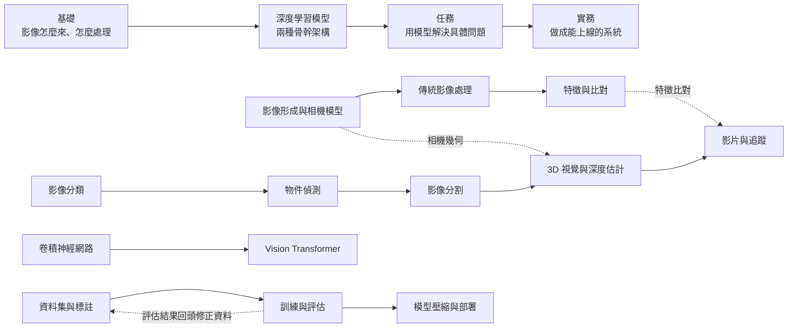

# 電腦視覺

給剛進團隊、會寫 Python 但沒做過電腦視覺專案的工程師與研究生：讀完能依任務選方法、讀懂主流模型架構，並從資料準備、訓練、評估做到部署。

## 維護者

- lufor129（GitHub: lufor129）

## 全景圖

第一部分是深度學習之前的底子：相機模型會在 3D 視覺用到，特徵比對會在追蹤用到。第二部分介紹兩種骨幹架構，第三部分的各種任務都建在這兩種骨幹上。第四部分把模型做成產品，評估出來的結果常常會回頭修正資料。

## 搬遷進度

部門有三份舊的電腦視覺教育訓練簡報，之後會用 kb-add 一章一章整理進手冊，每章一個變更提案。自監督學習與基礎模型之後再另加一章，放在第二部分。
