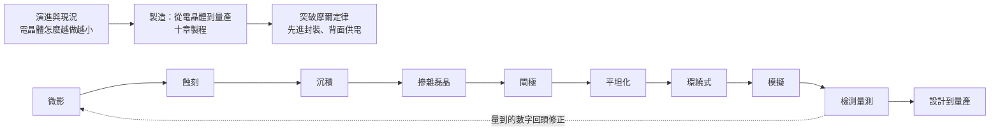

# 半導體製程

給半導體新人的知識庫：從電晶體結構演進、十章製程與量產，到先進封裝與背面供電。

## 維護者

- lufor129（GitHub: lufor129）

## 全景圖

第二部分的十章照一片晶圓實際走過的順序排；檢測量測量到的數字，會回頭修正前面的製程。

## 搬遷進度

手冊從原本的半導體簡報一章一章抽出來，每章一個變更提案；第一批是微影、閘極、檢測量測。還沒抽出的章仍在簡報裡，簡報照舊能播。
