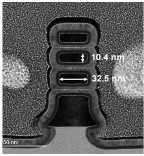
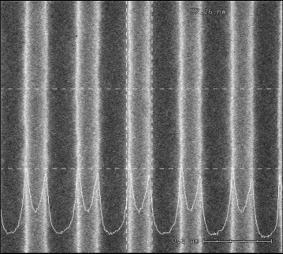

# 檢測量測

- 速覽：晶圓要走上千道步驟，每台機台每天都會慢慢跑掉一點；這一章講廠裡怎麼在小偏差變成整批報廢之前把它抓出來。檢查分三種：製程中的量測（尺寸對不對）和檢測（哪裡有缺陷），以及晶圓做完後的 WAT（電性對不對）。讀完你會知道 TEM、SEM、OCD 三種量尺寸的工具各怎麼量、各有什麼盲點，以及 OCD 為什麼要靠模型、還要拿 TEM 對答案；檢測怎麼從缺陷的分布形狀推回是哪台機台；量到的數字怎麼交給 SPC 判定、交給 APC 自動修正；最後是 WAT 量哪些電性，又怎麼和尺寸、缺陷的資料串起來找出問題。
- 先修：微影、模擬

## 量測、檢測、WAT：工廠的三種檢查

- 短標題：三種檢查：量測、檢測、WAT
- 英文：Metrology · Inspection · WAT
- 建議：2.8 分
- 圖：eyes

結論：TCAD 要靠量測校正，但量測更大的工作是**每天顧產線**。廠裡有三種檢查：製程中，**量測**問「尺寸對不對」、**檢測**問「哪裡有缺陷」；晶圓做完後，**WAT** 直接量「電性對不對」。切換看看三種檢查各看到什麼。

比喻（eye）：健康檢查：量血壓是量測，照胃鏡找息肉是檢測，抽血化驗是 WAT。

旁白：
第九章：檢測量測。前面說 TCAD 要靠量測校正，但這只是量測的一小部分工作。量測更大、每天都在做的事是顧產線：上千道製程裡，每一台機台每天都會慢慢漂，量測就是負責在它變成報廢之前抓到。還記得第一部分[[頁:cost]]嗎？一顆晶片要過一千五百道關卡，每一關 99.9% 都對，全部走完也只剩兩成。量測和檢測，就是讓每一關都守住的人。這是在座很多人未來每天的工作。

廠裡有三種檢查。第一種叫量測：量尺寸對不對。看畫面，量測是抽幾片晶圓、每片量幾個點，每個點得到一個數字，例如線寬 15.1 奈米。量的東西主要是線寬，英文叫 CD，也就是關鍵尺寸，還有膜厚、上下兩層有沒有對準的疊對。產線上的量測機台主要是膜厚機、CD-SEM、OCD 和疊對機；TEM 是實驗室的參考工具。這一章用線寬當代表，膜厚和疊對的道理一樣。

切到第二種：檢測。檢測不量尺寸，而是把整片晶圓掃一遍，找缺陷：微粒、刮痕、不該接的線接起來。得到的是缺陷在哪裡、是什麼。

切到第三種：WAT，晶圓允收測試。前兩種都在製程中途做；WAT 是整片晶圓做完之後，在晶片之間走道上的測試結構扎針，量電壓、電流、電阻，確認電晶體和導線的電性對。三種是不同的機台，在廠裡常常也是不同的團隊。就像健康檢查：量血壓、量身高是量測，照胃鏡找息肉是檢測，抽血化驗是 WAT。

這一章就跟著一片晶圓走，路線在右邊中間那張卡。製程中：先看第一種檢查，量尺寸的三種工具 TEM、SEM、OCD，以及 OCD 背後的模型；再看第二種，檢測怎麼找缺陷、推回是哪台機台；接著看這些數字每天拿來做什麼，也就是 SPC 和 APC。晶圓做完：用第三種檢查 WAT 量電性，再和量到的尺寸對照。晶圓做完之後，第十章把鏡頭拉遠，看一個新製程怎麼從設計走到量產、良率怎麼爬上去；再來的 CP、封裝，就接到第三部分。

## 工廠的三種檢查：量測、檢測、WAT

- 深入：eyes
- 圖：同主頁
- 建議：3 分

重點：
- 量測問「尺寸對不對」，檢測問「哪裡有缺陷」，WAT 問「電性對不對」
- 晶粒之間的切割道放測試和量測結構，不佔用真正的晶片
- 三種檢查用不同的機台，常常也是不同的團隊

說明：
一顆先進晶片要走大約一千五百道步驟。就算每一步有 99.9% 的機會做對，全部走完也只剩兩成左右是好的。而這上千道步驟裡，每一台機台每天都會慢慢「漂」，也就是一點一點偏離原本的設定。檢查的工作，就是在機台的小偏差變成整批報廢之前把它抓出來，讓每一關都守住。

模擬那一章講的 TCAD（Technology Computer-Aided Design，在電腦裡模擬製程和電晶體的軟體），要拿真實晶片量到的數字來校正；但那只是量測工作的一小部分。量測更大、每天都在做的事，是顧好產線。

先認識晶圓上的兩個地方。一片晶圓上並排做著幾百顆晶片，還沒切開時，每一顆叫**晶粒**（Die）；切割、封裝之後，才是我們手上的一顆顆晶片。晶粒和晶粒之間留著一條條走道，叫**切割道**（Scribe Line）。之後切晶片時，這條走道會被切掉，所以廠裡拿它來放測試和量測用的結構，不必佔用真正的晶片。

廠裡有三種檢查，各問一個問題：

- **量測**（Metrology）問「尺寸對不對」：抽幾片晶圓、每片量幾個點，每個點得到一個數字。量的主要是線寬、膜厚（Film Thickness），以及上下兩層圖案有沒有對準的疊對（Overlay）。
- **檢測**（Inspection）問「哪裡有缺陷」：不量尺寸，而是把整片晶圓掃一遍，找微粒、刮痕、不該接的線接起來，得到缺陷在哪裡、是什麼。
- **晶圓允收測試**（Wafer Acceptance Test, WAT）問「電性對不對」：前兩種在製程中途做；WAT 是整片晶圓做完之後，在切割道上的測試結構扎針，量電壓、電流、電阻。

三種用的是不同的機台，在廠裡常常也是不同的團隊。就像健康檢查：量血壓、量身高是量測，照胃鏡找息肉是檢測，抽血化驗是 WAT。

| | 量測 | 檢測 | WAT |
|---|---|---|---|
| 問什麼 | 尺寸對不對 | 哪裡有缺陷 | 電性對不對 |
| 什麼時候 | 製程中 | 製程中 | 晶圓做完後 |
| 得到 | 線寬、膜厚、疊對 | 缺陷的位置和種類 | 電壓、電流、電阻 |
| 怎麼看 | 抽幾片、量幾個點 | 抽片後整片掃 | 扎切割道上的測試結構 |
| 工具 | 膜厚機、CD-SEM、OCD、疊對機（TEM 當參考） | 光學掃描＋複檢 SEM、電子束 | 探針卡＋測試機 |
| 接下來 | 交給 SPC、APC | 推回是哪台機台 | 放行，或回推是哪一站 |

表裡的工具和縮寫，後面各節會一一介紹。這一章跟著一片晶圓走。製程中：先看量尺寸的三種工具 TEM、SEM、OCD，以及 OCD 背後的模型；再看檢測怎麼找缺陷、推回是哪台機台；接著看這些數字每天拿來做什麼，也就是 SPC 和 APC。晶圓做完：用 WAT 量電性，再和量到的尺寸對照。之後的 CP、封裝，接到從設計到量產那一章和第三部分。

## 量尺寸的三種工具：TEM、SEM、OCD

- 短標題：量測：怎麼看見奈米
- 英文：Metrology Toolbox
- 建議：2.5 分
- 圖：metro

結論：量測最常量的是 **CD**（Critical Dimension，關鍵尺寸，例如線寬）。TEM、SEM 用電子**直接看**；OCD 打光、再用模型**反推**。沒有一種全能：越快的越依賴模型，越直接的越慢、越要破壞。

重點：
- 生產線上主要用快速、不破壞的 SEM、OCD
- TEM 是參考：校正別人、找問題原因
- **疊對**：上下兩層有沒有對準，要控制在幾奈米內；有拍照比對的，也有像 OCD 一樣看繞射光的

比喻（eye）：接續健康檢查：切片化驗最準但要開刀（TEM）、照相看外觀（SEM）、體脂計量電阻再用模型推算（OCD，最快，但準不準看模型）。

旁白：
先看第一種檢查：量測，量尺寸。第八章說 TCAD 要拿真實晶片來校正，靠的也是這些工具。量測最常量的就是 CD，也就是線寬。尺寸只有十幾奈米，用什麼量？三種工具，從最清楚講到最快。

第一種是穿透式電子顯微鏡 TEM，要把晶片切成極薄的片，可以直接看到原子。畫面上是一顆環繞式電晶體的 TEM 照片，三片奈米片被閘極包住，連一奈米的絕緣層都看得到。但晶片切開就毀了，所以它是「參考」：用來校正其他工具、找出問題的原因。

第二種是電子顯微鏡 SEM，用電子束從上方掃描，看線寬對不對，不用切開，速度中等，但只看得到表面。第三種是光學散射 OCD，打一道光到切割道上專門做的量測靶，分析反射光譜，用模型反推出 3D 形狀，速度最快；要量 3D 形狀時，生產線上最常用它。順帶一提，廠裡最常量的還有膜厚和疊對：膜厚也是打光、用模型反推；疊對是上下兩層有沒有對準，要控制在幾奈米內：有拍照比對兩層標記位置的，也有像 OCD 一樣看繞射光的；EUV 多重曝光的時代，疊對是曝光站最要命的量測。

右邊四個量條要一起看：OCD 最快、不破壞，但最依賴模型，而且量的是測試靶，不是真正的電路。沒有一種工具是全能的，所以要搭配使用。

接續健康檢查的比喻：TEM 像切片化驗，最準但要開刀；SEM 像照相看外觀；OCD 像體脂計，量電阻再用模型推算，最快，但準不準要看模型。接下來五頁：TEM、SEM、OCD，最後兩頁深入 OCD 的模型。

## 量尺寸的三種工具：TEM、SEM、OCD

- 深入：metro
- 圖：同主頁
- 建議：3 分

重點：
- TEM 最清楚但要切壞晶片；SEM 不用切但只看表面；OCD 最快但全靠模型
- 越快的越依賴模型，越直接的越慢、越要破壞，所以要搭配使用
- 除了線寬，最常量的還有膜厚和疊對

說明：
線條只有十幾奈米寬，一般的尺量不到。要相信量出來的數字，得先知道手上有哪幾把「尺」，各自的長處和盲點在哪裡。

量測最常量的是**關鍵尺寸**（Critical Dimension, CD），例如線寬。常用的工具有三種，從最清楚講到最快：

- **穿透式電子顯微鏡**（Transmission Electron Microscope, TEM）：把晶片切成極薄的片，讓電子穿過去，直接看到原子。最清楚，是大家拿來對照的「參考」，但晶片就毀了。
- **掃描式電子顯微鏡**（Scanning Electron Microscope, SEM）：用電子束從上方掃描表面，看線寬對不對。不用切開，但只看得到表面。
- **光學散射量測**（Optical Critical Dimension, OCD；也叫 Scatterometry）：打一道光到切割道上專門做的量測靶，分析反射光，再用模型反推 3D 形狀。最快、完全不接觸，但最依賴模型，而且量的是量測靶，不是真正的電路。

| | TEM | SEM | OCD |
|---|---|---|---|
| 速度 | 很慢 | 中等 | 快 |
| 怎麼得到尺寸 | 直接看 | 演算法從影像判定 | 全靠模型反推 |
| 量得到真實電路嗎 | 能 | 能，但只看得到表面 | 只量量測靶 |
| 會破壞晶片嗎 | 會 | 不會 | 不會 |

沒有一種工具是全能的：越快的越依賴模型，越直接的越慢、越要破壞，所以要搭配使用。生產線上主要用快速、不破壞的 SEM 和 OCD；TEM 拿來校正其他工具、找出問題的原因。

接續健康檢查的比喻：TEM 像切片化驗，最準但要開刀；SEM 像照相看外觀；OCD 像體脂計，量身體的電阻再用模型推算體脂，最快，但準不準要看模型。

### 線寬以外：膜厚和疊對

先簡單交代晶片怎麼「印」出來（細節在微影、蝕刻兩章）。晶片是一層一層做出來的：每一層先塗上光阻（Photoresist，照到光會變質的感光膠），用曝光機把光罩（Photomask，刻著電路圖案的底片）上的圖案照上去，叫曝光；再用藥水把照到光的部分洗掉，叫顯影（Develop）；最後用蝕刻把圖案挖進下面的材料。

除了線寬，廠裡最常量的還有兩種：

- **膜厚**：每一層薄膜有多厚，也是打光、再用模型反推。
- **疊對**：上下兩層圖案有沒有對準。每一層都要對準前一層，誤差要控制在幾奈米內，否則上下兩層接不準：例如接觸孔（把上面的金屬接到電晶體上的小洞）會接歪，造成短路。疊對是晶圓廠數量最多的量測之一，量的是專門做的疊對標記，不是曝光機自己對位用的對準標記；有拍照比對兩層標記位置的，也有像 OCD 一樣看繞射光的。當一層圖案要拆成好幾次曝光來印（多重曝光，見微影那一章），每一次都要和其他次對準，疊對就成了曝光站最要命的量測。

這一章用線寬當代表，膜厚和疊對的道理一樣。

## 穿透式電子顯微鏡 TEM：讓電子穿過超薄切片

- 短標題：量測①：穿透式電子顯微鏡 TEM
- 英文：TEM
- 建議：1.9 分
- 圖：tem

結論：想看清電晶體內部，只能把它**切開、削到比電晶體還薄**，再讓電子穿過去成像。最清楚，但晶片就毀了。

重點：
- 看得到原子，是校正其他工具的「參考」
- 要把晶片切壞，一個樣品要幾小時到一天
- 也有誤差：影像是整片薄片的投影，切的位置也會影響

數字卡：約 10–30 nm｜樣品要削到的厚度，比一顆電晶體還薄，電子才穿得過

比喻（eye）：切片化驗：最準，但要開刀取樣；而且要切成像紙一樣薄的一片，對著光才看得清楚每一層。

旁白：
量測第一種工具：穿透式電子顯微鏡 TEM，上一頁和第一部分時間軸那張環繞式電晶體的剖面照，就是用它拍的。

它最大的特點是：電子要「穿過」樣品。電晶體被包在晶片深處，所以得先把它挖出來。第一步，在晶圓上找到想看的那一顆電晶體。第二步，用聚焦離子束，也就是一道很細的離子光束，在它兩側挖出兩個坑。第三步，把中間那一片削薄，薄到大約十到三十奈米，比電晶體本身還薄。第四步，讓電子束穿過這片薄片，穿過多少電子就決定影像的明暗。第五步就是結果：連一奈米的絕緣層都看得清清楚楚。

代價是晶片被切壞了，而且一個樣品要花幾小時到一天。所以 TEM 用在研發、找問題原因，以及當作其他量測的「參考」，不能每片都做。

注意，TEM 也不是絕對的真值。影像是整片薄片疊起來的投影，薄片裡如果包含不只一個結構，邊界就會糊掉；切在哪個位置、薄片多厚，也會影響量到的數字。所以業界叫它「參考量測」。下一頁看不用切開的方法：SEM。

## 穿透式電子顯微鏡 TEM：讓電子穿過超薄切片

- 深入：tem
- 圖：同主頁
- 建議：1.5 分

重點：
- 用聚焦離子束挖出一片比電晶體還薄的切片，讓電子穿過去
- 連極薄的絕緣層都看得清楚，是其他量測的參考
- 做一個樣品很花時間，晶片也毀了，只能抽查
- 影像是整片薄片的投影，也不是絕對的真值

說明：
其他量測工具準不準，最後都要拿 TEM 來對照；想知道一顆電晶體真正長什麼樣子，也要靠它。

TEM 最大的特點是電子要「穿過」樣品。電晶體被包在晶片深處，所以得先把它挖出來，做成一片比電晶體還薄的切片：

1. 在晶圓上找到想看的那一顆電晶體。
2. 用聚焦離子束（Focused Ion Beam, FIB），也就是一道很細的離子光束，在它兩側挖出兩個坑。
3. 把中間那一片削薄，薄到大約 10–30 nm，比一顆電晶體還薄，電子才穿得過。
4. 讓電子束穿過這片薄片；穿過多少電子，就決定影像的明暗。
5. 得到影像：連 1 nm 的絕緣層都看得清清楚楚。

上圖是研究用樣品的 TEM 剖面（Qian 等人的論文）：一顆環繞式電晶體，三片奈米片被閘極包住。

代價是晶片被切壞了，而且一個樣品要花幾小時到一天。所以 TEM 用在研發、找問題原因（例如在壞掉的位置切片看個究竟），以及當作其他量測的「參考」，不能每片都做。

TEM 也不是絕對的真值。影像是整片薄片疊起來的投影，薄片裡如果包含不只一個結構，邊界就會糊掉；切在哪個位置、薄片多厚，也會影響量到的數字。所以業界叫它**參考量測**（Reference Metrology）。

就像切片化驗：最準，但要開刀取樣；而且要切成像紙一樣薄的一片，對著光才看得清楚每一層。

## 電子顯微鏡 SEM：用電子束「掃」過表面，量出線寬

- 短標題：量測②：電子顯微鏡 SEM
- 英文：CD-SEM
- 建議：2.2 分
- 圖：sem

結論：TEM 要把晶片切開；SEM 不用切，用聚焦到約 1 奈米的電子束**從上方掃描表面**。電子打到**邊緣會噴出特別多電子**，所以邊緣最亮；再用**演算法**從亮度曲線判定邊在哪裡，算出線寬。

重點：
- 電子束直徑約 1 nm，比光細幾百倍
- 線寬靠演算法從亮度曲線判定兩個邊
- 限制：只看得到表面；電子會讓光阻縮一點

比喻（eye）：用手電筒斜照一塊浮雕：凸起的邊緣最亮。但亮邊本身有寬度，邊要畫在哪裡，得先定好一套規則。

旁白：
量測第二種工具：掃描式電子顯微鏡 SEM。上一頁的 TEM 要把晶片切開，SEM 不用切，直接從上面掃描表面，所以生產線上可以大量使用。晶圓廠裡最常用的是專門量線寬的 CD-SEM；後面檢測會講到的複檢 SEM 是另一種機台，用來看缺陷長什麼樣子。

為什麼用電子？光的粗細大約幾百奈米，看不清十幾奈米的線條；電子束可以聚焦到大約一奈米。左邊是剖面：電子束從左到右掃過表面，打到材料會噴出一些電子，偵測器就收集這些電子。關鍵是：打到平面時噴出的電子少，打到邊緣時噴出特別多，所以影像上邊緣特別亮。

右邊是一點一點拼出來的影像和亮度曲線。每條線都有兩條亮邊，但亮邊有寬度，「邊到底在哪裡」要靠演算法判定，例如取亮度的某個比例當邊界。所以 SEM 報出的線寬是演算法定義的，同一套規則量出來的數字才能互相比較。右上角就是 SEM 報出的線寬。

還有兩個限制。第一，SEM 只看得到表面，洞底、奈米片底下看不到。第二，量光阻時，電子會讓光阻縮一點，量越多次縮越多，所以同一個點不能一直量。實務上每批抽幾片、每片抽幾十個點，不是每片都量。

就像用手電筒斜照浮雕，邊緣最亮，但邊要畫在哪裡，得先定好規則。下一頁看最快、完全不接觸的方法：OCD。

## 電子顯微鏡 SEM：用電子束掃過表面，量出線寬

- 深入：sem
- 圖：同主頁
- 建議：2 分

重點：
- 低能量電子束從上方掃描，不用切開晶片
- 邊緣噴出的電子最多，影像上線條的邊特別亮
- 邊界在哪裡要靠演算法判定，同一套規則量的數字才能比
- 只看得到表面；量光阻時還會讓光阻縮一點

說明：
生產線上量線寬，最常用的就是 SEM。它報出的數字是怎麼來的，決定了不同機台、不同時間量到的數字能不能互相比較。

TEM 要把晶片切開；SEM 不用切，直接從上方掃描表面。它用的是低能量的電子束，不會破壞晶片，所以生產線上可以大量使用。晶圓廠裡最常用的是專門量線寬的 **CD-SEM**；檢測那一節會講到的複檢 SEM，是另一種用來看缺陷長什麼樣子的機台。

為什麼用電子而不用光？光的粗細大約幾百奈米，看不清十幾奈米的線條；電子束可以聚焦到大約 1 nm，比光細幾百倍。（後面的 OCD 也用光，但它不是「看」出形狀，而是從反射光譜反推，所以不受這個限制。）

原理是這樣：電子束一點一點掃過表面，打到材料會噴出一些電子，偵測器收集這些電子，拼成影像。打到平面時噴出的電子少，打到邊緣時噴出特別多，所以影像上線條的邊緣特別亮。

[^sem-1]

上圖是真實的 CD-SEM 俯視照，線寬 38 nm[^sem-1]。每條線都有兩條亮邊，但亮邊本身有寬度，「邊到底在哪裡」要靠演算法判定，例如取亮度曲線的某個比例當邊界。所以 SEM 報出的線寬是演算法定義的，同一套規則量出來的數字才能互相比較。就像用手電筒斜照一塊浮雕：凸起的邊緣最亮，但邊要畫在哪裡，得先定好一套規則。

SEM 還有兩個限制：

- **只看得到表面**：洞底、奈米片底下都看不到。
- **會讓光阻縮一點**：量光阻時，電子會讓光阻微縮，量越多次縮越多，所以同一個點不能一直量，量到的線寬也要校正。

實務上每批抽幾片、每片抽幾十個點，不是每片都量。

[^sem-1]: 出處：Song, Kim, Lee, “A Study on the Resolution and Depth of Focus of ArF Immersion Photolithography”, Micromachines 13, 1971 (2022), Fig. 1a, https://doi.org/10.3390/mi13111971

## 光學散射 OCD：從反射光的顏色反推形狀

- 短標題：量測③：光學散射 OCD
- 英文：Optical CD / Scatterometry
- 建議：3.7 分
- 圖：ocd

結論：OCD 不用看清楚，而是靠**反推**：不同形狀的結構，反射出來的各種顏色強弱都不一樣。試著調整左邊的猜測，**讓藍線和黑線重疊**，就找到了模型裡最像的形狀。

重點：
- 不接觸、不破壞，幾秒就量完
- 量的是切割道上的**週期性量測靶**，得到整塊的平均
- 要先建好準確的「形狀—光譜」模型

數字卡：幾秒 vs 幾小時｜OCD 量一個點的時間，對比 TEM 做一個樣品的時間

比喻（eye）：體脂計：不用開刀，量身體的電阻，再用模型推算體脂。推得準不準，要看模型。

旁白：
【可略】時間緊時：出題只做第三題（有「腳」的陷阱題），第一、二題留給課後玩。

量測第三種工具：光學散射，業界叫 OCD。前兩種都是用電子直接看，OCD 改成用光反推。要量 3D 形狀時，它是生產線上最常用的方法，因為它不接觸、不破壞，而且幾秒鐘就量完。

先講它量在哪裡。光斑大約幾十微米，比一顆電晶體大上千倍，所以 OCD 不是量某一顆電晶體，而是量切割道上專門做的量測靶：一整排一模一樣、週期性排列的線條。量到的是這一整塊的平均。真正電路裡的結構，要靠它和量測靶長得夠像來代表。

原理是這樣：打一道包含各種顏色的光到量測靶上，不同形狀的結構，反射回來的各種顏色強弱都不一樣，這條「顏色強弱曲線」叫光譜，就是右邊的黑線。問題是：光譜不會直接告訴你形狀，要反推。

請試試看：調整左邊猜測的寬度和高度，電腦會算出這個形狀應該產生的光譜，也就是藍色虛線。當藍線和黑線完全重疊，就找到模型裡最像的形狀，實際形狀就會顯示出來。但「最像」一定對嗎？兩頁後會看到陷阱。或者按「電腦自動比對」，看電腦怎麼一步步找到答案。

實際上電腦會事先算好幾十萬組形狀的光譜，量到之後很快找出最像的那一個。它也是抽樣：每批抽幾片、每片量幾個量測靶。實際機台還會看不同偏振、不同入射角的光，資訊更多，才分得出複雜的 3D 形狀。就像體脂計，不用開刀，量電阻再用模型推算。

想多玩的話，按「出題：下一題」。每題藏一個不同的形狀，對到吻合就會揭曉答案。第三題是陷阱：真實形狀的底部多了一個「腳」，這是模型裡沒有的參數，所以怎麼調都對不齊，最像也只有八成左右；硬對出最像的那組，電腦會把底部的腳當成整根變胖，寬度多算三奈米多。這就是 OCD 的風險：模型少一個參數，量出來的數字照樣很漂亮，但它是錯的。

所以前提是模型要準：藍線是怎麼算出來的？下一頁來看。

## 光學散射 OCD：從反射光反推形狀

- 深入：ocd
- 圖：同主頁
- 建議：2 分

重點：
- 量的是切割道上週期排列的量測靶，不是真正的電路
- 打光量反射光譜，再找模型裡光譜最像的形狀
- 模型少了參數時光譜對不齊，報出的數字卻可能看起來很合理

說明：
要量 3D 形狀時，OCD 是生產線上最常用的方法：不接觸、不破壞，幾秒鐘就量完一個點，而 TEM 做一個樣品要幾小時。但它的數字是「反推」出來的，懂原理才知道它什麼時候會騙人。

**量在哪裡**：OCD 的光斑大約幾十微米，比一顆電晶體大上千倍，所以它不是量某一顆電晶體，而是量切割道上專門做的**量測靶**（Metrology Target）：一整排一模一樣、週期性排列的線條。記憶體陣列這種本身就一格一格重複的區域，也可以直接量。量到的是這一整塊的平均；真正電路裡的結構，要靠量測靶設計得和它夠像來代表。有疑問時，再用 SEM 看真正的電路、用 TEM 切開確認。

**原理**：打一道包含各種顏色的光到量測靶上。不同形狀的結構，反射回來的各種顏色強弱都不一樣，這條「顏色強弱曲線」叫**光譜**（Spectrum）。問題是光譜不會直接告訴你形狀，要反推：先猜一個形狀，例如鰭（Fin，鰭式電晶體裡豎起來的細長矽條）的寬度和高度，算出這個形狀應該產生的光譜，和量到的光譜比；不像就換一組再算，直到兩條曲線重疊，就找到了模型裡最像的形狀。

實際上電腦會事先算好幾十萬組形狀的光譜（下一節講這本「答案本」怎麼建），量到之後很快找出最像的那一組。實際機台還會看不同偏振、不同入射角的光，資訊更多，才分得出複雜的 3D 形狀。它也是抽樣：每批抽幾片、每片量幾個量測靶。

**陷阱：模型少了一個參數**。假設真實形狀的底部多了一個「腳」，而模型裡沒有這個參數。那麼不管怎麼調，算出來的光譜都和量到的對不齊，最像也只有八成左右吻合；硬挑最像的那一組，電腦會把底部的腳當成整根變胖，寬度多算三奈米多（數字為示意）。吻合度偏低是一個警訊；但如果只看報出來的線寬，數字照樣很合理。

還有一種更難發現的情況：模型的參數都在，光譜也完全吻合，數字卻還是錯的。這要靠 TEM 對答案才抓得到，在「拿 TEM 對答案」那一節講。

就像體脂計：不用開刀，量身體的電阻，再用模型推算體脂。推得準不準，要看模型。

## OCD 的答案本：參數化形狀＋n、k，再用 RCWA 算

- 短標題：OCD 補充①：建答案本（參數化 → RCWA）
- 建議：3.2 分
- 圖：ocdf

結論：OCD 只量得到光譜，要先有一本**「形狀 ↔ 光譜」對照表**才查得出線寬。做法：從**設計值和 TEM 剖面**看出真實形狀，寫成幾個參數，填入各材料的**光學常數 n、k**，再用 RCWA 正著算出光譜。

旁白：
上一頁按「電腦自動比對」，藍線一下就對上黑線。這一頁和下一頁，把 OCD 背後的道理講清楚。先講目的、原因，再講做法。

先看問題：機台其實只量到一條曲線，各種顏色的反射率。光譜不會直接告訴你形狀，那 14.1 奈米是怎麼來的？答案是：要先有一本答案本，記錄「每種形狀會反射出什麼光譜」。

做法第一步，參數化形狀。先看設計值：左邊這個，直角、照設計圖。有時候也會用第八章的 TCAD 先估一下形狀，但這不是必經步驟，而且 TCAD 太理想，前面已經看過。再拿 TEM 切一片真的樣品來看：實際上角是圓的、側壁是斜的，尺寸也和設計不一樣。最後，照 TEM 看到的樣子，把形狀寫成幾個參數：這裡是一條梯形的鰭，頂上蓋一層硬遮罩。硬遮罩是蝕刻時蓋在鰭頂上保護它的一層硬材料，例如氮化矽。整個形狀用上寬、下寬、高、硬遮罩厚四個數字描述，每個參數會在什麼範圍，看 TEM 和製程經驗來定。

第二步，填入光學常數 n 和 k。n 是光進到材料裡會折多少，k 是會被吸收多少，每種材料、每個波長都不一樣，要先拿薄膜樣品量好。這一步很容易被忽略，但 n、k 錯了，整本答案本都會偏，下一頁就會看到這種例子。

第三步，RCWA，嚴格耦合波分析：光碰到這麼小的結構會繞射、互相干涉，所以要解光的波動方程。RCWA 先把形狀切成一層層薄片，並且假設這個形狀左右無限重複，這就是為什麼量測靶要做成週期性的。算出來就是每個形狀「應該」反射出的光譜。

第四步：把參數範圍內的形狀都算一遍，存成對照表。四個參數、每個取三十個值，就是八十一萬組。

最後大家可以自己試：拖形狀參數，光譜就跟著變；把 RCWA 切到「粗略」，只切三層，光譜就算歪了。數字都是示意。下一頁看量到光譜之後，怎麼查出線寬，又怎麼知道它準不準。

## OCD 的答案本：參數化形狀、n 與 k、RCWA

- 深入：ocdf
- 圖：同主頁
- 建議：3.5 分

重點：
- 參照 TEM 看到的樣子，把形狀寫成幾個參數，例如上寬、下寬、高
- 每種材料的光學常數 n、k 要先量好，錯了整本都偏
- 用 RCWA 算每個形狀的光譜，存成「形狀 ↔ 光譜」對照表

說明：
OCD 機台其實只量到一條曲線：各種顏色的反射率。它能報出線寬，是因為事先有一本「形狀 ↔ 光譜」對照表可以查。這本答案本怎麼建，決定了 OCD 的數字準不準。

建答案本分四步：

1. **參數化形狀**：先從設計值出發，設計圖上是直角（有時也會用 TCAD 先估一下形狀，但這不是必經步驟，而且 TCAD 太理想）。再拿 TEM 切一片真的樣品來看：實際上角是圓的、側壁是斜的，尺寸也和設計不一樣。最後照 TEM 看到的樣子，把形狀寫成幾個參數。例如一條梯形的鰭，頂上蓋一層硬遮罩（Hard Mask，蝕刻時蓋在鰭頂上保護它的硬材料，例如氮化矽），就用**上寬、下寬、高、硬遮罩厚**四個數字描述；側壁有多斜（側壁角）由上寬、下寬和高一起決定，上下寬度差越少，側壁越直。每個參數會落在什麼範圍，看 TEM 和製程經驗來定。
2. **填入光學常數 n、k**：n 是折射率（Refractive Index），代表光進到材料裡會折多少；k 是消光係數（Extinction Coefficient），代表光會被吸收多少。每種材料、每個波長都不一樣，要先拿薄膜樣品量好。這一步很容易被忽略，但 n、k 錯了，整本答案本都會偏；材料配方一改，n、k 就跟著變。
3. **用 RCWA 算光譜**：光碰到這麼小的結構會繞射、互相干涉，所以要解光的波動方程。**嚴格耦合波分析**（Rigorous Coupled-Wave Analysis, RCWA）先把形狀切成一層層薄片，並假設這個形狀左右無限重複，這就是量測靶要做成週期性的原因。算出來的，就是每個形狀「應該」反射出的光譜。切得太粗，光譜就算不準。
4. **存成對照表**：把參數範圍內的形狀都算一遍，存成「形狀 ↔ 光譜」對照表。例如 4 個參數、每個取 30 個值，就是 30⁴，大約 81 萬組（數字為示意）。量產前先用電腦叢集算好，也可以量的時候即時算。現在也會用機器學習來加速或輔助建模。

可以想成替一個蛋糕建一本「敲擊聲音表」：先看食譜，再切一塊實物看清楚，把蛋糕寫成「多高、多寬、奶油多厚」，查好每種材料的音色（n、k），再預測敲起來的聲音（RCWA），記成一本表。之後只要敲一下、聽聲音，就能查出蛋糕的形狀。

### 藏在裡面的尺寸：環繞式電晶體

環繞式電晶體（Gate-All-Around, GAA）讓量測更難。它的做法是先交替疊上一層矽鍺、一層矽，再把夾在中間的矽鍺溶掉，留下一片片懸空的矽奈米片，最後讓閘極把每一片包起來。溶掉矽鍺之前，還要先把每層矽鍺的兩端往內溶一點，在缺口裡填上絕緣材料，叫**內間隔層**（Inner Spacer），用來把後來包進去的閘極和兩旁的源極、汲極隔開。

這些尺寸都藏在結構裡面，從上面看不到：內間隔層往內做了幾奈米、矽鍺有沒有溶乾淨、矽片有沒有被吃薄，都只能間接量。做法是多種方法搭配：

- OCD 把這些藏起來的尺寸也放進模型一起反推，並用多角度、多偏振的光取得更多資訊。
- 疊層每層多厚、矽鍺裡有多少鍺，用 X 光（X 光繞射）量。
- 電子束看埋住的結構通不通（見檢測那一節的電子束檢測）。
- TEM 抽查當參考。
- 最後用 WAT 量到的電性回推。

這是環繞式時代量測最難、最需要人的地方。

## 量到光譜之後：查出 CD，再拿 TEM 對答案

- 短標題：OCD 補充②：查 CD、用 TEM 對答案
- 建議：3 分
- 圖：ocdb

結論：生產線上量到光譜，在答案本裡**反著查**出線寬。但查到的是**模型的答案**，模型錯了光譜照樣吻合；所以要定期拿 **TEM 切片量到的線寬**來對答案，偏了就修模型。

旁白：
這一頁是 OCD 在生產線上真正做的事：量到光譜，查出線寬。一樣先講目的和原因。

目的：從光譜得到線寬，而且確定數字是對的。原因：答案來自模型，模型如果錯了，光譜照樣吻合，數字卻會偏掉，光看 OCD 自己是看不出來的。

做法第一步，查表：量到的光譜在答案本裡找最像的那一組，光譜完全吻合，報出那一組的線寬 14.1 奈米，看起來很完美。

第二步，抽幾個點做 TEM 對照：把同一批位置切開，用 TEM 量線寬，當作參考值。右邊的圖，橫軸是 TEM、縱軸是 OCD，完全一致的話點會落在綠色虛線上。結果橘色趨勢線斜斜的：細的量太粗、粗的量太細，這是系統性偏差，代表模型有問題。注意，這些點都貼著同一條線，代表趨勢一致，但整條偏掉，這叫準度差。精度是另一件事：在同一個點重複量好幾次，數字穩不穩。OCD 的精度通常很好，準度要靠 TEM 校正。量測機台本身也要被管，後面 SPC 那頁會講。

第三步，找原因、修模型。這個例子的原因是：鰭頂上那層硬遮罩換了配方，它的折射率 n 從 2.02 變成 1.95，就是上一頁填進模型的那個 n。模型還在用舊值，整本答案本都偏了。重新量 n、更新答案本之後，點就回到一致線上。

【可略】第四步時間不夠可以略過。為什麼光譜吻合還會錯？看左邊：把鰭的上寬加寬一點、側壁變直一點，中間的寬度沒變，算出來的光譜幾乎一模一樣。兩個參數的影響可以互相抵消，叫做參數相關。右邊的參數空間裡，整條綠線上的每一組都和量到的光譜吻合，光看光譜，答案不唯一。解法叫混合量測：每種工具量自己最準的那個數字。CD-SEM 從上面看，最擅長量上寬，就把它量到的上寬固定給 OCD，OCD 只解剩下的側壁和高度，就只剩一個答案。這正好回扣[[頁:sem]]的 CD-SEM。

最後一步大家可以自己切換校正前後、換量測點。所以 OCD 和 TEM 是搭檔：TEM 一個點要幾小時，只抽十幾個點當參考；OCD 校正好之後，每片抽幾個量測靶，幾秒一個。就像體脂計，要定期拿到醫院的標準儀器對照。數字都是示意。建模型、找 n、k、跟 TEM 對答案、追偏差，就是 OCD 量測工程師的日常。

量尺寸的工具講到這裡。接著看第二種檢查：檢測，找缺陷。

## 查出線寬之後：拿 TEM 對答案

- 深入：ocdb
- 圖：同主頁
- 建議：3.5 分

重點：
- OCD 的精度通常很好，準度要靠 TEM 校正
- 對答案時，整條平移或斜率不對，都代表模型有問題
- 參數相關時光譜一樣、答案不唯一：用混合量測，讓 CD-SEM 固定上寬
- 三種工具的線寬定義不同，以 TEM 為參考建立對照關係

說明：
OCD 的數字來自模型。上一節的「腳」是模型少了參數，光譜對不齊，至少還看得到警訊；更麻煩的是光譜完全吻合、數字卻是錯的情況，這時光看 OCD 自己完全看不出來。所以 OCD 一定要定期「對答案」。

**查表**：生產線上量到光譜，在答案本裡反著查，找最像的那一組，報出那一組的線寬。光譜完全吻合，看起來很完美。

**對答案**：抽幾個點，把同一批位置切開做 TEM，量出線寬當參考值。把每個點的兩個數字畫在一起（橫軸 TEM、縱軸 OCD），完全一致的話，點會落在對角線上。偏離有兩種典型：

- **整條平移**：每個點都多算（或少算）差不多的量，叫偏移（Offset）。
- **斜率不對**：細的量太粗、粗的量太細（或反過來）。

兩種都是系統性偏差：點仍然排成一條線，趨勢是對的，但不在對角線上，代表模型有問題。

這裡要分清楚兩個詞：

- **精度**（Precision）：同一點重複量好幾次，數字穩不穩。
- **準度**（Accuracy）：數字和參考值（TEM）差多少。

OCD 的精度通常很好，準度要靠 TEM 校正。量測要多準才夠，廠裡用兩種方式評估：GR&R（Gauge Repeatability and Reproducibility，看同一台機台重複量、以及換一台機台量同一片時，數字差多少），或「量測誤差 ÷ 規格範圍」，叫 P/T 比（Precision-to-Tolerance Ratio）。原則是量測誤差只能佔規格範圍的一小部分，具體門檻依各廠規定。

**找原因、修模型**：舉一個例子（數字為示意）。鰭頂上那層硬遮罩換了配方，它的折射率 n 從 2.02 變成 1.95，模型卻還在用舊值。用舊的 n 算出來的答案本，整本都偏了：查表時一樣找得到光譜完全吻合的那一組，只是那一組的線寬是錯的，細的量太粗、粗的量太細。重新量 n、更新答案本之後，點就回到對角線上。

**吻合也可能錯：參數相關**。把鰭的上寬加寬一點、下寬窄一點，側壁就變直一點；只要中間的寬度沒變，算出來的光譜幾乎一模一樣。兩個參數的影響互相抵消，叫**參數相關**（Parameter Correlation）：光看光譜，答案不唯一，線寬也可能跟著報錯。解法是**混合量測**（Hybrid Metrology）：每種工具量自己最準的那個數字。CD-SEM 從上面看，最擅長量上寬，就把它量到的上寬固定給 OCD，OCD 只解剩下的下寬（也就是側壁角）、高和硬遮罩厚，答案就只剩一個。

### 三種工具量同一條線，數字不一樣，誰對？

TEM、SEM、OCD 量同一條線，數字通常不會完全一樣，因為三者的「線寬」定義本來就不同：SEM 是演算法從亮邊判定的寬度；OCD 是模型裡那個梯形在某個高度的寬度；TEM 是整片薄片的投影。所以廠裡不要求三者數字一樣，而是建立彼此的對照關係（差多少偏移、斜率多少），以 TEM 當參考；同一站固定用同一種工具、同一套規則，看數字的趨勢。

### OCD 和 TEM 是搭檔

TEM 一個點要幾小時，只抽十幾個點當參考；OCD 校正好之後，每片抽幾個量測靶，幾秒一個。量測機台本身也要被管：每天量標準片（尺寸已知、很穩定的參考晶圓，量它就知道機台自己有沒有漂），同型機台互相比對，量測誤差要遠小於規格範圍（SPC 那一節會再提）。建模型、找 n 和 k、跟 TEM 對答案、追偏差，就是 OCD 量測工程師的日常。

就像家裡的體脂計每天量（OCD），定期拿到醫院的標準儀器對照（TEM）；差太多就要調整。

## 檢測：找出缺陷，推回是哪台機台

- 短標題：檢測：缺陷地圖
- 英文：Inspection · Defect Map
- 建議：3.3 分
- 圖：insp

結論：**檢測**不量尺寸，而是在整片晶圓上找**缺陷**：微粒、刮痕、短路。流程是**掃描 → 複檢 → 分類**，最後看缺陷在晶圓上的**分布形狀**，就能推回是哪台機台出問題。看完動畫，猜猜看原因。

重點：
- 光學掃描：每顆晶粒和**隔壁晶粒比對**，不一樣的地方就是可疑點（盲點：光罩上的缺陷每顆都有，比不出來，第十章講光罩）
- 靈敏度兩難：調太高**誤報**一堆，調太低會**漏抓**
- 抽片後整片掃；複檢 SEM 才抽點放大看
- 藏在裡面的缺陷（片下殘留、接觸孔沒通）光學看不到 → **電子束檢測**：看得更小、還看得出電性，但很慢，只抽關鍵區
- 量產時**每片缺陷數也上管制圖**：某批突然暴增（excursion）就扣貨查機台

比喻（eye）：健康檢查：量血壓是量測（數字對不對）；照胃鏡找息肉是檢測（哪裡有異常）。

旁白：
【可略】時間緊時：只讓台下猜 A、B 兩張，另外六張留給課後。

尺寸量完，接著看第二種檢查：檢測。量測問的是「尺寸對不對」，檢測問的是「哪裡有缺陷」，像微粒、刮痕、不該接的線接起來。

看動畫，分四步。

第一步，光學掃描。光學檢測機台把整片晶圓掃一遍。它不知道正確答案長怎樣，方法是把每一顆晶粒和隔壁晶粒比對：右邊三顆晶粒，圖案本來一模一樣，中間這顆多了一個點，和左右都不一樣，就標成可疑點。這時候只知道哪裡怪怪的，不知道是什麼。靈敏度調太高，會抓到一大堆其實沒事的誤報；調太低又會漏抓，這是檢測工程師每天在拿捏的。這招也有盲點：如果缺陷來自光罩，每一顆晶粒同一個位置都有，和隔壁比對完全一樣，就比不出來；一格只放一顆大晶片時特別麻煩。光罩怎麼另外檢查，第十章會講。

第二步，複檢。用複檢 SEM 抽幾個可疑點放大看，到底是刮痕、短路、微粒，還是其實沒事。注意它和前面量線寬的 CD-SEM 是不同用途的機台。

第三步，分類。哪些是這次要找的缺陷，標紅色；哪些是其他來源，標灰色。

第四步，看紅點在晶圓上的分布形狀，推回是哪台機台出問題。請大家猜：一條弧線，通常是 CMP 刮傷；每個曝光格同一個位置都有，是光罩髒了；集中在外圈，是邊緣的蝕刻或沉積不均，或晶邊的膜剝落；一團擠在一起，是機台掉了微粒。後面還有四張進階題：集中在正中央，是塗佈機或沉積噴頭；一條筆直的線，是搬運手臂刮到，和 CMP 的弧線不一樣，因為手臂是直線移動；半徑中間繞一整圈，是 CMP 研磨頭某一圈壓力不對；只有半邊，是晶圓放偏或夾盤一邊溫度不同。每張只給四個選項，右下角會記錄破解幾張。時間緊的話，猜前兩張就好，其他留給有興趣的人課後玩。

量產時，檢測最大量的工作其實是天天數缺陷：每一站每片掃到幾顆，也畫成管制圖，平常的水準叫 baseline，某一批突然暴增叫 excursion，就扣貨、查機台；機台每天也跑乾淨的監控片，看多掉了幾顆微粒。下一頁的管制圖，就是這樣用的。

量測的數字、檢測的缺陷地圖，每天都在大量產生。接下來看這些數字拿來做什麼：SPC。

## 檢測：找出缺陷，推回是哪台機台

- 深入：insp
- 圖：同主頁
- 建議：5.5 分

重點：
- 光學掃描把每顆晶粒和隔壁比對，標出可疑點，再用複檢 SEM 確認、分類
- 缺陷地圖的分布形狀，常常直接指向是哪台機台
- 一格只放一顆大晶片時，光罩上的缺陷比對不出來
- 光學看不到的缺陷要用電子束檢測，但很慢

說明：
量測問「尺寸對不對」，檢測問「哪裡有缺陷」。一顆微粒、一道刮痕，就可能讓兩條線短路、整顆晶粒報廢；而缺陷在晶圓上的分布形狀，常常直接指向是哪台機台出了問題。

檢測不量尺寸，而是在整片晶圓上找缺陷（Defect）：微粒、刮痕、不該接的線接起來（短路）。流程分四步：

1. **光學掃描**：光學檢測機台把整片晶圓掃一遍。它不知道正確答案長怎樣，方法是把每一顆晶粒和隔壁晶粒比對：圖案本來一模一樣，和左右都不一樣的地方，就標成可疑點。這時只知道哪裡怪怪的，還不知道是什麼。
2. **複檢**：用複檢 SEM（Review SEM）抽幾個可疑點放大看，到底是刮痕、短路、微粒，還是其實沒事。它和量線寬的 CD-SEM 是不同用途的機台。
3. **分類**：哪些是這次要找的缺陷，哪些是其他來源，哪些其實是誤報。複檢影像的分類，現在也常用 AI 自動做。
4. **看分布形狀**：把缺陷畫在晶圓上，就是**缺陷地圖**（Wafer Map），上面標的是一顆顆缺陷的位置。從分布的形狀推回是哪台機台出問題，通知那台機台停機檢查，修好再放行。

### 抓到的不一定是真缺陷，真缺陷也不一定致命

光學掃描的靈敏度是兩難：調太高，會抓到一大堆其實沒事的誤報；調太低又會漏抓。所以才要用複檢 SEM 抽點放大確認、分類，把誤報過濾掉。這個拿捏是檢測工程師的日常。

反過來，一顆真的缺陷也不一定會讓晶粒壞掉，要看落在哪裡、多大：落在空白區或不重要的位置，可能沒事；剛好讓兩條線短路或斷路，那顆晶粒就壞了。所以分類時，也要評估哪些缺陷「殺得死」晶片。

### 晶粒比對的盲點：光罩上的缺陷

曝光機不是一次印滿整片晶圓，而是一次印一塊固定大小的範圍，叫**曝光格**（也叫曝光區），一格一格印滿整片晶圓。光罩上的圖案就是一格的內容：小晶片的話，一格裡會並排放好幾顆晶粒；很大的晶片（例如 AI 晶片），一格可能只放得下一顆。

光罩上如果有一個污點，曝光機每印一格就印一次，所以每一個曝光格的同一個位置都會有這個缺陷，每一片晶圓也都有，叫重複缺陷。一格有好幾顆晶粒時，污點只落在其中一顆的位置，同一格裡隔壁的晶粒是乾淨的，晶粒比對抓得到；缺陷地圖上出現「每一格同一個位置都有」，就要懷疑光罩。但一格只放一顆大晶片時，每一顆晶粒的同一個位置都有同樣的缺陷，和隔壁比起來一模一樣，就比不出來。這時要改用和設計資料比對，或直接檢查光罩。

所以光罩本身也要檢測。光罩出廠前要和設計圖檔逐點比對；進了晶圓廠，用久了會沾微粒，也要定期拿下來重驗。EUV（極紫外光，目前最細的曝光光源）的光罩是反射式的，像一面鏡子，表面鍍了很多層膜，缺陷可能埋在多層膜裡，要用 EUV 波長的光罩檢測等方法。細節在從設計到量產那一章。

### 光學看不到的缺陷

藏在裡面的缺陷，例如奈米片底下的殘留、接觸孔沒通，光學看不到，要用**電子束檢測**（E-beam Inspection）：用電子束而不是光去掃描，看得到更小的缺陷，還看得出電性問題（例如接觸孔沒接通）。代價是很慢，只掃關鍵區域或抽樣。

EUV 的隨機缺陷也要靠電子束和大量取樣。微影那一章講過，EUV 的光子很少，有些小洞會隨機印不開，或相鄰的線黏在一起（橋接）。這種缺陷隨機、稀少、每次位置都不一樣，抽幾個點量不到：要讓 CD-SEM 量大量接觸孔的尺寸、看整體分布，用電子束檢測大面積掃「沒開的洞」和「橋接」，再把結果回饋給曝光劑量（照多少光）和光阻的選擇。

### 從分布形狀推回機台

先認識表裡幾種機台和用語：CMP（Chemical Mechanical Planarization，化學機械研磨）是把每一層表面磨平的步驟，研磨頭把晶圓壓在旋轉的研磨墊上，加研磨液一起磨，壓力分成好幾圈控制；旋轉塗佈是把光阻之類的液體滴在旋轉的晶圓上甩開鋪平；電漿是蝕刻、沉積時用的帶電氣體；晶舟是裝晶圓的架子。

常見的分布形狀和原因如下。這些是教科書型態，實際判讀要搭配複檢結果和機台紀錄：

| 分布形狀 | 常見原因 | 先查哪裡 |
|---|---|---|
| 一條弧線 | 研磨墊上卡了硬顆粒，跟著旋轉畫出弧形刮痕 | CMP 機台的研磨墊和研磨液 |
| 每個曝光格的同一個位置都有 | 光罩上有髒東西，每曝一格就印一次 | 光罩 |
| 集中在最外圈 | 晶圓邊緣的電漿、氣流、溫度和中間不一樣，或晶邊的膜剝落 | 蝕刻或沉積機台的邊緣參數 |
| 一團擠在某個地方 | 機台腔體掉下一團微粒 | 停機清腔體 |
| 集中在正中央 | 旋轉塗佈時中心的液體或氣流條件不同，或沉積噴頭中央出問題 | 塗佈機或噴頭 |
| 一條筆直的線 | 搬運時被機械手臂或夾具刮到（手臂是直線移動；CMP 刮出來的則是弧線，因為研磨墊在轉） | 搬運手臂和晶舟 |
| 半徑中間繞一整圈 | CMP 研磨頭分好幾圈施壓，某一圈壓力不對 | 研磨頭的分區壓力 |
| 只有半邊 | 晶圓放偏，或承載晶圓的夾盤一邊溫度不同 | 晶圓放置位置和夾盤溫度 |

量產時，檢測最大量的工作其實是天天數缺陷：每一站每片掃到幾顆，也畫成管制圖（下一節），某一批突然暴增就扣貨、查機台。

就像健康檢查：量血壓是量測，看數字對不對；照胃鏡找息肉是檢測，看哪裡有異常。

## SPC 統計製程管制：量完先判定

- 短標題：SPC：管制圖與判定
- 英文：SPC · Statistical Process Control
- 建議：4.8 分
- 圖：mloop

結論：前面量到的數字（線寬、膜厚、疊對，還有每片缺陷數）拿來做什麼？交給 **SPC**（Statistical Process Control，統計製程管制）：拿數字和**三條線**比，**判定**機台有沒有變、這批怎麼處理；自動修正則交給下一頁的 **APC**。依序按 ①～④ 看一遍。

重點：
- **三條線**：綠＝目標；橘虛線＝**管制線**（這台機台平常抖多少）；紅＝**規格**（產品能接受多少）
- 超出管制線＝**機台變了**；超出規格＝**產品不合格**

比喻（eye）：量體溫：37.3 度還不算發燒（規格內），但比你平常高（超出管制線），就該注意了。

旁白：
尺寸和缺陷都看過了。量測每天量出一大堆數字，拿來做什麼？這就是[[頁:eyes]]說的顧產線。

先看最上面這條分工圖：量測量完的數字，先交給 SPC，英文 Statistical Process Control，統計製程管制，負責判定機台有沒有變、這批要怎麼處理，有異常就找人處理；再交給 APC，先進製程控制，自動算出下一批要調多少，下一頁講。這一頁先看 SPC。

SPC 的核心是這張管制圖，每個點是一批晶圓量出來的平均線寬，目標 15 奈米。先看三條線：綠色點線是目標；紅線是規格，是產品能接受多少，超過紅線產品就不合格；橘色虛線是管制線，是看這台機台平常抖多少算出來的，通常取正負三個標準差。所以管制線比規格嚴，它回答的不是「產品好不好」，而是「機台有沒有變」。打個比方：量體溫，37.3 度還不算發燒，這是規格內；但如果你平常都是 36.5，今天突然 37.3，就該注意了，這是超出管制線。

右邊的判定階梯，就是量完之後要做的決定。我們依序按上面四個按鈕。

① 機台很穩：點都在綠色帶子裡上下抖，判定 PASS，晶圓放行。

② 開始漂：注意紫色框，連續七點都偏在目標上面，雖然還沒超線，在管制圖的規則裡已經算異常，叫偏移或連串，各廠規定連續 7 到 9 點不等。判定變成「放行＋偏移警報」：產品沒問題，但要去查機台，這就是提早發現。

③ 超出管制線：點跑進黃色區，還在規格內，產品通常沒問題，但機台已經變了，判定 ADJUST，要調機台。超出管制線，廠裡叫 OOC；超出規格叫 OOS。

④ 超出規格：點跑進紅色區。這時要看是在哪一站量的。點一超出規格，圖上方就會出現流程條，下面也會出現「曝光後量／蝕刻後量」的切換：曝光之後量一次，蝕刻之後再量一次，廠裡分別叫 ADI 和 AEI。下面切「曝光後量」：流程條亮的是第一個量測站，超規格的點變成綠色空心圈加一個回頭箭頭，因為這時候圖案還只是光阻，洗掉重新曝光就好，叫 REWORK，廠裡說重工，管制圖右下角寫「幾批洗掉重做：救回來了」，代價只是時間和成本。切回「蝕刻後量」：同樣的漂移，同樣幾批，現在變成紅色叉叉，因為圖案已經挖進下面的材料，挖掉的回不來，整批先扣住，工程師評估，多半報廢。所以廠裡會在曝光後先量一次，在還救得回來的時候把關。實際上曝光後量的是光阻線寬，目標值和蝕刻後不一樣，這裡畫在同一個刻度上方便比較。管制圖右下角的計數也看一下：第一次超線之後，如果沒人處理，又跑了十幾批，其中好幾批超出規格，這就是晚處理的代價。

還有一個關鍵：超線的時候，第一步不是怪機台，而是先確認量測本身沒出錯。每一張管制圖都附一份事先寫好的處置清單，超線時照著一步一步查，廠裡叫 OCAP。量測機台每天要量標準片，確認自己沒漂；同一型的幾台機台要互相比對，量同一片要得到一樣的數字；量測本身的誤差也要遠小於規格範圍，量出來的數字才有意義。另外量測都是抽樣：每批抽幾片、每片量幾個到幾十個點，不是每片每顆都量。管制規則和處置流程，各廠都有自己的規範，畫面上是示意。

管制圖上不只放尺寸。檢測掃到的每片缺陷數，也一樣上管制圖：每一站有平常的缺陷基準，叫 baseline；某一批突然暴增，叫 excursion，要馬上扣貨查機台。機台本身每天也要跑一片乾淨的監控片，進機台走一趟再掃一次，看多了幾顆微粒，叫 adder，超線就停機清理。

這一頁的處置都要靠人：工程師看到警報、去查、去調機台。能不能讓系統每批自己修？下一頁就是 APC。

## SPC 統計製程管制：量完先判定

- 深入：mloop
- 圖：同主頁
- 建議：5.5 分

重點：
- 管制圖上有目標、規格、管制線；管制線是從機台平常的資料算出來的
- 超出管制線代表機台變了；超出規格代表產品不合格
- 顯影後超規格還能重工，蝕刻後超規格多半報廢
- 超線時先確認量測沒出錯，照處置清單（OCAP）一步步查

說明：
量測每天量出一大堆數字：線寬、膜厚、疊對，還有每片的缺陷數。數字本身不會救產線，要有一套規則判斷「機台有沒有變、這批要怎麼處理」。

量到的數字依序交給兩個系統：

量測 → SPC（判定機台有沒有變，異常就找人處理）→ APC（自動算出下一批要調多少）→ 機台

這一節講 SPC，下一節講 APC。

**統計製程管制**（Statistical Process Control, SPC）的核心是**管制圖**（Control Chart）：例如把每一批晶圓蝕刻後的平均線寬，照時間一個點一個點畫上去。圖上有三條線：

- **目標**：希望做到的值。
- **規格**（Specification Limit）：依產品需要「訂」出來的，代表產品能接受多少。超過規格，產品就不合格。
- **管制線**（Control Limit）：從這台機台平常的資料「算」出來的，不是人訂的。先算出平常的平均，以及數字平常上下抖多大；抖動的大小叫標準差（Standard Deviation，寫成 σ），抖得越大，σ 越大。管制線通常畫在平均的正負三個標準差（±3σ）。機台沒變的時候，幾乎所有的點都會落在這個範圍內，所以點跑出去，多半不是運氣，而是機台真的變了。

管制線通常比規格嚴。它回答的不是「產品好不好」，而是「機台有沒有變」：超出管制線，代表機台變了；超出規格，代表產品不合格。打個比方：量體溫，37.3 度還不算發燒，這是規格內；但如果你平常都是 36.5 度，今天突然 37.3 度，就該注意了，這是超出管制線。

### 判定：最新一批落在哪裡

量完要做決定。下表是判定的階梯（規則與處置為示意，依各廠規範）：

| 判定 | 情況 | 怎麼處理 |
|---|---|---|
| 放行（PASS） | 在管制線內，前面也沒有連續偏移 | 機台很穩，晶圓繼續往下一站 |
| 放行＋偏移警報 | 在管制線內，但點一直往同一邊跑 | 產品放行，但機台在漂：先確認不是量測出錯（重量一次、看標準片），再查機台、調參數 |
| 調機台（ADJUST） | 超出管制線，還在規格內 | 產品通常沒問題：先確認不是量測出錯，依程序先扣住確認，通常放行；同時調機台，或讓 APC 修下一批的參數 |
| 重工（REWORK） | 超出規格，曝光後量的 | 先確認不是量測出錯，再把光阻洗掉、重新曝光，晶圓救得回來 |
| 扣住評估（HOLD） | 超出規格，已經蝕刻或沉積下去 | 挖掉的回不來：整批先扣住，由工程師評估重做、報廢、降級或特准放行（多半是報廢或降級）；同時追查是哪台機台 |

表裡有幾個廠裡常用的詞：

- **偏移**：連續好幾點都偏在目標同一邊（各廠規定連續 7 到 9 點不等），雖然還沒超線，在管制圖的規則裡已經算異常，也叫連串。這就是提早發現。
- **OOC 與 OOS**：超出管制線，廠裡叫 OOC（Out of Control）；超出規格，叫 OOS（Out of Spec）。
- **ADI 與 AEI**：同樣超出規格，要看是在哪一站量的。顯影之後量一次、蝕刻之後再量一次，廠裡分別叫 ADI（After Develop Inspection）和 AEI（After Etch Inspection）。顯影後超規格，圖案還只是光阻，洗掉重新曝光就好，叫**重工**（Rework），代價只是時間和成本；蝕刻後超規格，圖案已經挖進下面的材料，挖掉的回不來，多半報廢。所以廠裡會在顯影後先量一次，在還救得回來的時候把關。（ADI 量的是光阻線寬，目標值和蝕刻後不一樣。）

處理得晚也有代價：第一次超出管制線之後如果沒人處理，機台繼續漂，接下來跑的十幾批裡，就會有好幾批超出規格。

### 先確認量測沒出錯

超線的時候，第一步不是怪機台，而是先確認量測本身沒出錯。每一張管制圖都附一份事先寫好的處置清單，超線時照著一步一步查，廠裡叫 OCAP（Out-of-Control Action Plan）。量測機台每天要量標準片，確認自己沒漂；同一型的幾台機台要互相比對，量同一片要得到一樣的數字；量測本身的誤差也要遠小於規格範圍，量出來的數字才有意義。

另外量測都是抽樣：每批抽幾片、每片量幾個到幾十個點，不是每片每顆都量。重要的步驟抽多一點、穩定的步驟抽少一點；抽樣太多會拖慢產能，太少會漏掉問題，這是量測工程師要拿捏的。

### 管制圖上不只放尺寸

檢測掃到的每片缺陷數，也一樣上管制圖。每一站有平常的缺陷水準，叫**基準**（Baseline）；某一批突然暴增，叫 **Excursion**，要馬上扣貨查機台。機台本身每天也要跑一片乾淨的**監控片**（Monitor Wafer），進機台走一趟再掃一次，看多了幾顆微粒，叫 **Adder**，超線就停機清理。

### 管制圖之外：Cpk 看製程能力夠不夠

管制圖問的是「機台有沒有變」。另一個常用的指標 **Cpk**（Process Capability Index，製程能力指標）問的是「這個製程的能力夠不夠」：看製程的平均離規格邊界有多遠，算法是（最近的規格邊界 − 平均）÷ 3 個標準差。製程抖得越小、平均越靠近目標，Cpk 越大，越不容易做出超規格的產品，越安全；常見要求是 1.33 以上（依廠規）。

這一節的處置都要靠人：工程師看到警報、去查、去調機台。讓系統每一批自己修，就是下一節的 APC。

## APC 先進製程控制：自動算出下一批要調多少

- 短標題：APC：自動修正怎麼算
- 英文：APC · Advanced Process Control
- 建議：4.9 分
- 圖：apc

結論：**APC**（Advanced Process Control，先進製程控制）把量測接回機台：**這批偏多少，下一批就反過來補一部分**。補多少是門學問：太保守追不上，太衝會**來回震盪**；量測不準，APC 會把**量錯的數字也當真**去調。

比喻（eye）：開車握方向盤：偏了就輕輕修回來；修太猛，車子左右蛇行；看不清路（量不準），越修越歪。

旁白：
上一頁的機台一直漂，要靠人發現、處理。這一頁看讓系統每批自己修的方法：APC 是 Advanced Process Control，先進製程控制。上面的分工圖現在亮在 APC 這一段。

先講它和上一頁 SPC 的分工，看右邊的表。SPC 是監控：判定機台有沒有變，超線或出現趨勢，由工程師判定、處置，它怕的是誤報和漏抓。APC 是修正：每一批都由系統自動調，它怕的是量不準，以及把機台本身的問題藏起來。一個像警報器，一個像自動駕駛，兩個一起用。

上面是迴圈：曝光機做完一批，晶圓送去量測機量線寬，量到「這批比目標胖了多少」，交給 APC 電腦。APC 算出下一批的曝光劑量要修多少，再送回曝光機。規則很簡單：下一批的修正，等於這批的修正，再加上「修正力道」乘以這批偏了多少。這種一批一批修的方式，叫批次對批次控制，英文 run-to-run；最常用的算法叫 EWMA，畫面上的修正力道就是它的 λ。

中間是每批的線寬，灰線是沒有 APC 的樣子，也就是上一頁那種一直漂、最後漂出規格的情況；藍線是有 APC 的，點被拉回目標附近。

先玩修正力道。拉到 0，就是沒有修，藍線和灰線一樣。拉到兩三成，太保守，追得慢，線寬總是落後一截。拉到五成左右，剛好，點留在目標附近。拉過十成，也就是補的比偏的還多，下一批就偏到另一邊，開始一上一下；拉到十八成左右，越修越糟，來回震盪，比不修還差。開車握方向盤也是這樣：偏了輕輕修回來，修太猛，車子就蛇行。

再切「量測不準」。這是給量測工程師最重要的一點：APC 只看得到量到的數字。量測一不準，APC 就把量錯的部分也當成真的偏差，去「修」本來沒問題的批次，產品反而被調歪。畫面上多了一條淺藍虛線，是量測準的時候；藍線明顯更亂，力道越大越明顯，右上角會算出抖動是量測準時的幾倍。量測準不準，直接決定 APC 能做到多好。

再切「前饋」。前面講的是回饋：看這批的結果修下一批。但有些差異來自進來的晶圓本身，例如上一站鍍的膜每批厚薄不一樣，每批都不同，回饋追不上。前饋就是在上一站先把膜厚量好，這一批進來時直接補掉。還記得 CMP 那頁「磨前先量」嗎？就是前饋。打開後，藍線的上下抖動明顯變小。

最後看最下面那張圖：APC 每批調了多少。機台一直在漂，APC 就一直加大補償，管制圖看起來很漂亮，但機台的問題被藏起來了。所以廠裡也會把調整量本身畫成管制圖，超過上限，代表不是 APC 壞了，而是機台該保養了。

SPC 和 APC 也會互相配合：APC 調了多少，本身就畫成一張 SPC 管制圖來監控。

SPC 和 APC 都建立在一個前提：量到的數字要準，這也是前面花那麼多時間講量測工具和 OCD 模型的原因。製程中的檢查講到這裡；接下來晶圓做完了，看出廠前的最後一關：WAT。

## APC 先進製程控制：自動算出下一批要調多少

- 深入：apc
- 圖：同主頁
- 建議：4.5 分

重點：
- 下一批的修正 ＝ 這批的修正 ＋ 修正力道 × 這批偏了多少
- 力道太大會補過頭、來回震盪；太小追不上機台的漂移
- 量測不準，APC 會把量錯的部分當真，越修越歪
- 把 APC 每批調了多少也畫成管制圖，才看得出機台該保養

說明：
SPC 靠人發現、處理；APC 讓系統每一批自己修。修得好不好，取決於兩件事：修正的力道，以及量測準不準。

**先進製程控制**（Advanced Process Control, APC）把量測接回機台。以曝光為例：曝光劑量（Dose）是每次照多少光；照多一點或少一點，光阻被照開的範圍就跟著變，印出來的線寬就會變粗或變細，所以可以用劑量來微調線寬。曝光機做完一批，晶圓送去量測機量線寬，量到「這批比目標胖了多少」，交給 APC 電腦；APC 算出下一批的曝光劑量要修多少，再送回曝光機。

規則很簡單：

下一批的修正 ＝ 這批的修正 ＋ 修正力道 × 這批偏了多少

修正力道就是「這批偏多少，下一批補幾成」。這種一批一批修的方式，叫**批次對批次控制**（Run-to-Run Control）；最常用的算法叫 EWMA（Exponentially Weighted Moving Average，指數加權移動平均），修正力道就是它的 λ。

### 修正力道是門學問

力道越大，修得越快，但越容易補過頭；力道越小，修得越慢，但越不會被量測的雜訊帶著跑。

- **零**：等於沒有修，機台漂多少，產品就跟著漂多少。
- **小到追不上**：每次只補一點點，補的速度跟不上機台漂的速度，線寬總是落後一截。
- **偏小但追得上**：每批補一部分，機台的漂移被抵銷，點留在目標附近。實務上常選這個範圍（約 2–4 成）：補得夠追上機台，同時等於把好幾批的偏差加權平均，減少雜訊的影響。
- **太大**：補的比偏的還多（超過十成），下一批就偏到另一邊，開始一上一下；再加大，來回震盪得比完全不修還差。

就像開車握方向盤：偏了就輕輕修回來；修太猛，車子左右蛇行；看不清路，越修越歪。

### 量不準，APC 會越修越歪

這是給量測工程師最重要的一點：APC 只看得到量到的數字。量測一不準，APC 就把量錯的部分也當成真的偏差，去「修」本來沒問題的批次，產品反而被調歪，力道越大越明顯。這時只能把力道調小、多批平均；根本的解法，是把量測顧好。

### 回饋與前饋

前面講的是**回饋**（Feedback）：看這批的結果，修下一批。但有些差異來自進來的晶圓本身，例如上一站鍍的膜每批厚薄不一樣，每批都不同，回饋追不上。**前饋**（Feedforward）就是在上一站先把膜厚量好，這一批進來時直接補掉。平坦化那一章講的「磨前先量」，就是前饋。

### 別讓 APC 把機台的問題藏起來

機台一直在漂，APC 就一直加大補償，產品的管制圖看起來很漂亮，但機台的問題被藏起來了。所以廠裡也會把 APC 每批調了多少，本身畫成一張 SPC 管制圖來監控；調整量一直變大、超過上限，代表不是 APC 壞了，而是機台該保養了。

### SPC 和 APC 怎麼分工

一個像警報器，一個像自動駕駛，兩個一起用：

| | SPC | APC |
|---|---|---|
| 做什麼 | 監控：機台有沒有變 | 修正：下一批調多少 |
| 誰動手 | 工程師判定、處置 | 系統自動 |
| 多快 | 看趨勢，超線才動 | 每一批都調 |
| 怕什麼 | 誤報、漏抓 | 量不準；把機台問題藏起來 |

### 虛擬量測與 AI

量測是抽樣，不是每片都量。**虛擬量測**（Virtual Metrology）補上沒量到的那些片：不實際量，而是用機台的感測資料（溫度、壓力、電漿功率、時間）加上 AI 模型，預測這片量出來會是多少。這樣每片都有估計值，真的量測就拿來校正模型。好處是快，前提是模型要一直跟真實量測對答案。

晶圓廠用 AI 的地方不只這裡：預測良率、找缺陷的規律、調機台參數，以及計算光罩修正（微影那一章講的曲線光罩，就靠 GPU 加速計算）。在量測和檢測裡，AI 用在複檢 SEM 影像的缺陷自動分類、虛擬量測、用機器學習加速或輔助 OCD 建模，以及 SEM 影像去雜訊、抓輪廓。前提都一樣：要一直拿真實量測（TEM、複檢）當標準答案來校正。

SPC、APC、虛擬量測都建立在同一個前提：量到的數字要準。這也是前面花那麼多篇幅講量測工具和 OCD 模型的原因。

## WAT：晶圓出廠前的健康檢查

- 短標題：WAT①：出廠前的健康檢查
- 英文：Wafer Acceptance Test
- 建議：3.8 分
- 圖：wat

結論：量測看「尺寸」、檢測找「缺陷」，**WAT 直接量「電」**：整片晶圓做完後，在晶片之間走道上的**測試結構**扎針，量電晶體和導線的電性。合格才放行；不合格就扣住、回推是哪一站出問題。按「下一步」一步步看。

重點：
- **WAT**：Wafer Acceptance Test，晶圓允收測試
- 量的是**切割道上的測試結構**，不是真正的晶片
- WAT 管**製程**、CP 管**每一顆晶片**、FT 管**成品**

比喻（faucet）：房子蓋好後的水電驗收：不拆牆，用預留的測試插座量電壓、試水壓。驗收過了才交屋；哪一路不對，就找負責的師傅。

旁白：
【可略】時間緊時，第六步 CP、FT 只唸右邊表格那一行：WAT 管製程、CP 管每一顆、FT 管成品。

製程中的檢查講完了。最後看晶圓做完之後的第三種檢查，也是出廠前的最後一關：WAT，Wafer Acceptance Test，晶圓允收測試。前面的量測和檢測，都是在製程中途看尺寸、找缺陷；WAT 是整片晶圓上千道步驟全部做完之後，直接量「電」，確認做出來的電晶體和導線，電性真的對。

一步一步看。第一步，晶圓做完了：前面七章的步驟全部走完，一片晶圓上有幾百顆晶片。

第二步，放大看晶片和晶片之間：中間有一條走道，叫切割道。之後切晶片的時候，這條走道會被切掉，所以廠裡拿它來放測試用的東西。

第三步，再放大這條走道：一排金色的測試墊，中間夾著小電晶體、電阻、把很多導線孔串起來的導線孔鏈。它們和晶片裡真正的電晶體、導線，是用同一套製程、同時做出來的，所以量它，就知道晶片做得對不對，又不用去碰真正的晶片。這一整組測試結構，廠裡叫 test key。

第四步，探針卡壓下來，探針扎在測試墊上，加電壓、量電流，讀出一串數字：臨界電壓、開啟電流、關閉漏電、電阻。下一頁用水龍頭來解釋這些數字各代表什麼。每片晶圓通常量幾個點。

第五步，每一項都和規格比。全部合格，晶圓放行，送去下一關 CP。有一項超出規格，晶圓先扣住，看是哪幾項超、出現在晶圓哪裡，回推是哪一站出問題；下一頁會看每一項不合格代表什麼。

第六步，WAT 之後還有兩關。CP，英文 Chip Probing，晶圓針測：晶圓還沒切開，換一張對準每一顆晶片焊墊的探針卡，一顆一顆跑功能測試，電路會不會動、速度夠不夠、待機漏電多少。注意差別：WAT 量的是走道上的測試結構，回答「這片晶圓的製程對不對」；CP 測的是每一顆真正的晶片，回答「這一顆能不能用」。壞的晶片在電子晶圓圖上做記號，好的比例就是良率。記憶體晶片還可以在這一步啟用備用電路，把壞掉的部分修起來。接著切割，只把好的晶片拿去封裝，這就是第三部分的主題。封裝完再做 FT，Final Test，成品測試：每一顆成品再測一次，包括高溫、低溫，並依速度分等級，跑得快的賣得比較貴。

所以三關各管一件事：WAT 管製程、CP 管每一顆晶片、FT 管成品。就像房子蓋好後的水電驗收：不拆牆，用預留的測試插座量電壓、試水壓，過了才交屋。

## WAT：晶圓出廠前的健康檢查

- 深入：wat
- 圖：同主頁
- 建議：3 分

重點：
- 晶圓做完後，扎切割道上的測試結構，量電壓、電流、電阻
- 不合格就整片扣住，從晶圓圖回推是哪一站出問題
- WAT 看製程，CP 看每一顆晶粒，FT 看封裝後的成品

說明：
量測看尺寸、檢測找缺陷，但電晶體最後要通電才算數。WAT 是晶圓出廠前的最後一關：不看樣子，直接量「電」。

整片晶圓上千道步驟全部做完後，一片 12 吋晶圓上有幾百顆晶粒，電晶體和導線都做好了。WAT 在出廠前量一次電性，確認做出來的電晶體和導線真的對。

**量在哪裡**：量的是切割道上的測試結構。切割道上放著一排探針要扎的測試墊，中間夾著小電晶體、電阻，以及導線孔鏈（把很多導線孔串起來的一條鏈，下一節解釋）。這一整組**測試結構**（Test Structure），廠裡叫 test key。它們和晶片裡真正的電晶體、導線，是用同一套製程、同時做出來的，所以量它就知道晶片做得對不對，又不用去碰真正的晶片。

**怎麼量**：探針卡（Probe Card）壓下來，探針扎在測試墊上，加電壓、量電流，讀出一串數字：臨界電壓、開啟電流、關閉漏電、各種電阻（下一節逐項解釋）。每片晶圓通常量幾個點。

**和規格比**：每一項都和規格比。全部在規格內，晶圓放行，送去下一關 CP；有一項超出規格，晶圓先扣住，看是哪幾項超、出現在晶圓哪裡，回推是哪一站出問題，再由工程師評估要報廢、降級，還是特准放行。把每個點的結果畫在晶圓的形狀上，就是 WAT 的晶圓圖：問題集中在外圈、只有半邊、還是局部一塊，各指向不同的原因，判讀的方式和檢測的缺陷地圖類似。

### 後面還有兩關：CP 和 FT

- **晶片針測**（Chip Probing, CP）：晶圓還沒切開，換一張對準每一顆晶粒焊墊（對外接線用的金屬墊）的探針卡，一顆一顆跑功能測試：電路會不會動、速度夠不夠、待機漏電多少。測完的結果存成一張電子晶圓圖，標出每一顆晶粒是好是壞；好的比例就是**良率**（Yield）。這張圖和檢測的缺陷地圖都畫在晶圓的形狀上，但內容不同：缺陷地圖標的是一顆顆缺陷的位置，CP 的晶圓圖標的是每一顆晶粒測試的結果。記憶體晶片還可以在這一步啟用備用電路，把壞掉的部分修起來。接著切割，只把好的晶粒拿去封裝，這是第三部分的主題。
- **成品測試**（Final Test, FT）：封裝完，每一顆成品再測一次，包括高溫、低溫，並依速度分等級，跑得快的賣得比較貴。

注意 WAT 和 CP 的差別：WAT 量的是走道上的測試結構，回答「這片晶圓的製程對不對」；CP 測的是每一顆真正的晶粒，回答「這一顆能不能用」。一個看製程、一個看產品。

| | 測誰 | 什麼時候 | 不合格 |
|---|---|---|---|
| WAT | 切割道上的測試結構，每片幾點 | 晶圓做完 | 整片扣住，回推哪一站 |
| CP | 每一顆晶粒的功能 | 切割前 | 那一顆做記號，不封裝 |
| FT | 每一顆成品 | 封裝後 | 淘汰或降級 |

三關各管一件事：WAT 管製程、CP 管每一顆晶片、FT 管成品。所以每一顆晶片都會被測到：晶圓先過 WAT，每一顆晶粒過 CP，封裝後每一顆成品再過 FT。就像房子蓋好後的水電驗收：不拆牆，用預留的測試插座量電壓、試水壓。驗收過了才交屋；哪一路不對，就找負責的師傅。

## WAT 量什麼：把電晶體當成水龍頭

- 短標題：WAT②：量什麼（水龍頭）
- 英文：What WAT Measures
- 建議：2.5 分
- 圖：wat2

結論：還記得第一部分嗎？電晶體就是**用電壓控制的水龍頭**：源極是水塔、閘極是把手、汲極是出水口。WAT 量的，就是這個水龍頭**開得對不對、關得緊不緊、接頭和水管通不通**。點每一項看看。

重點：
- 前三項看**開關本身**：開得動、開得夠大、關得緊
- 後三項看**周邊**：墊片漏不漏、接頭和水管通不通
- 每一項都有規格範圍，超出就是不合格

比喻（faucet）：驗收一個水龍頭：轉多少才出水、全開水量多大、關緊會不會滴、把手會不會漏、接頭和水管有沒有堵。

旁白：
WAT 量的那一串數字，各代表什麼？用第一部分的水龍頭來看：源極是水塔，通道是水管，閘極是把手，汲極是出水口，絕緣層是把手和水管之間的墊片。左邊是水龍頭，右邊是真的電晶體，亮起來的就是這一項在量的地方。

前三項看開關本身。第一項 Vt，臨界電壓：把手要轉多少才開始出水。實際上是慢慢加大閘極電壓，看電流什麼時候開始變大。太低，輕輕一碰就出水、關不緊；太高，要轉很多才出水、開得慢。第二項 Ion，開啟電流：把手全開時水流多大，越大電晶體越快。第三項 Ioff，關閉漏電：把手關緊了，還在滴水，滴越多，手機放著不用也越耗電。

後三項看周邊。第四項 Ig，閘極漏電：水從把手的墊片漏出來，就是[[頁:hk1]]電子穿過絕緣牆。第五項 Rc，接觸電阻：水管的接頭太窄、卡卡的，電晶體本身沒事，但水送不進去、出不來。第六項是導線孔鏈：把整棟樓上千個水管接頭串成一條來量，只要有一個堵住，總阻力就變大，代表有導線孔沒填滿或斷掉。

每一項都有規格範圍。WAT 不合格時，就是看哪幾項超、出現在晶圓哪裡，回推是哪一站出問題：例如 Vt 偏低加上漏電變大，多半是閘極做太細；只有接觸電阻高，是中段接點。

下一頁是第九章最後一頁：把 WAT 量到的電性，和前面 OCD 量到的尺寸放在一起看。

## WAT 量什麼：把電晶體當成水龍頭

- 深入：wat2
- 圖：同主頁
- 建議：3 分

重點：
- 臨界電壓、開啟電流、關閉漏電，看開關本身
- 閘極漏電、接觸電阻、導線孔鏈電阻，看周邊
- Vt 偏低又漏電變大，多半是閘極做太細（短通道效應）

說明：
WAT 報告上是一串縮寫和數字。看懂每一項在量什麼，不合格時才知道該往哪裡找。

第一部分把電晶體比喻成用電壓控制的水龍頭：源極是水塔，通道是水管，閘極是把手，汲極是出水口，絕緣層是把手和水管之間的墊片。WAT 量的，就是這個水龍頭開得對不對、關得緊不緊、接頭和水管通不通。

後兩項量的是電晶體以外的連接，先交代一下。電晶體的源極、汲極、閘極都埋在絕緣層下面，要挖出比電晶體還小的接觸孔、填進金屬，才接得出來，這段製程叫**中段**（Middle of Line, MOL），填好金屬的接觸孔就是接點。再往上是十幾層導線，上下兩層導線之間靠**導線孔**（Via）接起來，導線孔也是填滿金屬的小孔。

| 項目 | 比喻 | 怎麼量 | 不合格代表 |
|---|---|---|---|
| 臨界電壓 Vt（Threshold Voltage） | 把手要轉多少，才開始出水 | 慢慢加大閘極電壓，電流開始變大時的那個電壓 | 太低：輕輕一碰就出水，關不緊；太高：要轉很多才出水，開得慢 |
| 開啟電流 Ion（On-Current） | 把手全開時，水流多大 | 閘極加到正常工作的電壓，量流過去的電流 | 太小：電晶體跑不快；太大：通常代表關不緊，漏電也大 |
| 關閉漏電 Ioff（Off-Current） | 把手關緊了，還在滴水 | 閘極不加電壓，量還漏過去的電流 | 太大：手機放著不用也在耗電、發熱 |
| 閘極漏電 Ig（Gate Leakage） | 水從把手的墊片漏出來 | 閘極加電壓，量直接穿過絕緣層的電流 | 太大：絕緣牆太薄或有缺陷 |
| 接觸電阻 Rc（Contact Resistance） | 水管接頭太窄、卡卡的 | 讓電流流過一串中段的接點，量電阻 | 太大：電晶體本身沒事，但電送不進去、出不來 |
| 導線孔鏈電阻（Via Chain Resistance） | 整棟樓的水管接頭有沒有堵 | 把上千個導線孔串成一條鏈，量總電阻 | 太大或不通：有導線孔沒填滿、斷掉 |

前三項看開關本身：開得動、開得夠大、關得緊。後三項看周邊：墊片漏不漏、接頭和水管通不通。閘極漏電，就是閘極那一章講的、電子穿過太薄的絕緣牆。導線孔鏈的道理是：把整棟樓上千個水管接頭串成一條來量，只要有一個堵住，總阻力就會變大。

每一項都有規格範圍，超出就是不合格。不合格時，看是哪幾項超、出現在晶圓哪裡，回推是哪一站出問題：

- **Vt 偏低加上漏電變大，多半是閘極做太細**。閘極的線寬，就是它底下通道的長度：閘極做細，通道就變短。通道太短，閘極管不住通道底部，電子容易從底下偷溜過去，這叫短通道效應（Short Channel Effect，第一部分講過）。結果是電晶體比較容易打開（Vt 偏低）、關著也漏得多（Ioff 變大），全開時的電流也會變大。
- **只有接觸電阻高**，電晶體本身的幾項都正常，就是中段的接點出問題。

就像驗收一個水龍頭：轉多少才出水、全開水量多大、關緊會不會滴、把手會不會漏、接頭和水管有沒有堵。

## WAT 和線上量測對照：尺寸和電性對得上嗎？

- 短標題：WAT④：和線上量測對照
- 英文：Inline Metrology vs WAT
- 建議：3 分
- 圖：wat4

結論：每個測試點都有兩個數字：製程中 **OCD 量到的線寬**，和最後 **WAT 量到的電流**。正常時兩者排成**一條線**：線寬細一點，電流大一點。**點沿著線跑，問題就是尺寸；點離開這條線，就要往尺寸以外找。**

重點：
- **沿著線跑** → 問題就是尺寸
- **尺寸正常、電流離開線** → 往尺寸以外找
- 廠裡也用這條線，決定線上量測的規格要訂多嚴

比喻（ruler）：體重和跑步成績：體重重一點，通常跑慢一點。體重正常卻跑很慢，就不是體重的問題，要找別的原因，例如腳受傷。

旁白：
第九章最後一頁，把 WAT 和前面的 OCD 放在一起看。每個測試點都有兩個數字：製程中 OCD 量到的閘極線寬，和最後 WAT 量到的開啟電流。橫軸是線寬，縱軸是電流，每個點是一個量測位置，累積了很多片晶圓，還有故意做粗、做細的實驗批，線才畫得出來。

① 正常的時候，點會排成一條線：線寬細一點，電流就大一點。這條線本身，就是廠裡拿線上量測和 WAT 一起畫出來的。

② 閘極太細：點沿著這條線往左上跑，線寬變細、電流變大，兩邊對得上，所以問題就是閘極線寬。接著要問：線上量測早就看到線寬偏了，為什麼 SPC 沒攔下來？常見原因有兩個：線上量測每片只抽幾個點，偏最多的外圈沒抽到；或管制線訂得比電性需要的鬆。所以廠裡會拿這條線，回頭決定線上量測的規格要訂多嚴。

③ 接點電阻高：線寬都正常，電流卻整批掉到線下方。尺寸量起來都對，電流卻不對，就不是尺寸的問題，要往尺寸以外找，WAT 的接觸電阻偏高，指向中段接點。

④ 一邊偏：線寬都差不多，電流卻上下散開，也不是尺寸的問題，查 WAT 的 Vt 在晶圓上的分布，一邊高一邊低。環繞式的通道幾乎不摻雜，Vt 主要由閘極金屬決定，所以指向閘極金屬的厚度或退火不均。

就像體重和跑步成績：體重重一點，通常跑慢一點；體重正常卻跑很慢，就要找別的原因。廠裡也靠這條線決定線上量測的規格要訂多嚴：線寬差多少，電流就會超規格。WAT 量到的電流和漏電，也是第八章 TCAD 校正、以及給晶片設計者用的元件模型的重要資料。數字都是示意。

第九章到這裡。右邊這張小卡把整章收成一句：量測工程師每天做四件事，選工具和量測點、設管制線、判定並回饋機台、量不準時追原因。你們之後的工作，大概就是這四件事的組合。

WAT 合格之後，晶圓送去 CP、切割、封裝，封裝就是第三部分要講的。在那之前，下一章先把鏡頭拉遠：一顆晶片從設計圖到量產的整條路，這些量測數據最後又怎麼變成良率。

## WAT 和線上量測對照：尺寸和電性對得上嗎？

- 深入：wat4
- 圖：同主頁
- 建議：3.5 分

重點：
- 把同一位置的線寬和開啟電流畫在一起，正常時排成一條線
- 點沿著線跑，問題是尺寸；點離開這條線，要往尺寸以外找
- 線寬偏了 SPC 卻沒攔下：抽樣沒抽到，或規格訂得比電性需要的寬

說明：
尺寸和電性是同一顆電晶體的兩面。把兩邊的數字放在一起看，才分得出問題是「尺寸做錯」，還是「別的地方出錯」。

每個測試點都有兩個數字：製程中 OCD 量到的閘極線寬，和最後 WAT 量到的開啟電流。OCD 的量測靶和 WAT 的測試結構都放在切割道上，也都只在晶圓上的固定幾個位置量；把同一片晶圓上、位置相近的兩個數字配成一對，就是圖上的一個點。這裡假設位置相近的量測靶和測試電晶體，做出來的線寬差不多。把它們畫在一起，橫軸是線寬、縱軸是電流。要累積很多片晶圓，還要有故意做粗、做細的實驗批，線寬才拉得開。

正常時，點會排成一條線：線寬細一點，電流就大一點（原因就是上一節講的短通道效應）。這條線本身，就是廠裡拿線上量測和 WAT 一起畫出來的。判讀的原則是：**點沿著線跑，問題就是尺寸；點離開這條線，就要往尺寸以外找**，例如接點、摻雜、絕緣層。三個例子：

- **閘極太細**：點沿著線往「線寬細、電流大」那一頭跑，兩邊對得上，所以問題就是閘極線寬。接著要問：線上量測早就看到線寬偏了，為什麼 SPC 沒攔下來？常見原因有兩個：線上量測每片只抽幾個點，偏最多的外圈剛好沒抽到；或線上量測的規格訂得比電性需要的寬，線寬還在規格內，電流卻已經超出 WAT 的規格。
- **接觸電阻高**：線寬都正常，電流卻整批掉到線的下方。尺寸量起來都對、電流卻不對，就不是尺寸的問題，要往尺寸以外找：WAT 的接觸電阻偏高，指向中段的接點。
- **一邊偏**：每個點的線寬都差不多，電流卻上下散開，也不是尺寸的問題。查 WAT 的 Vt 在晶圓上的分布：一邊高、一邊低。Vt 有兩個旋鈕：通道裡摻了多少雜質，以及閘極金屬抓電子的力氣（功函數，閘極那一章）。平面電晶體的時代，通道會摻少量雜質，靠摻雜量來調 Vt；鰭式和環繞式的通道幾乎不摻雜，第一個旋鈕幾乎用不到，Vt 主要就由閘極金屬（貼在絕緣層上的功函數金屬）的種類和厚度決定。所以線寬正常、Vt 卻一邊高一邊低，就指向閘極金屬的厚度不均，或退火（製程中的加熱處理）不均。

就像體重和跑步成績：體重重一點，通常跑慢一點；體重正常卻跑很慢，就不是體重的問題，要找別的原因，例如腳受傷。

這條線還有兩個用途。第一，廠裡靠它回頭決定線上量測的規格要訂多嚴：線寬差多少，電流就會超出 WAT 的規格。第二，WAT 量到的電流和漏電，也是模擬那一章的 TCAD 校正，以及給晶片設計者用的元件模型的重要資料。

### 晶片做壞了，怎麼找原因

CP 測出一批晶粒壞掉時，要把幾種資料疊在一起看：

1. **線上檢測的缺陷地圖**：看缺陷的分布形狀，猜是哪台機台。
2. **WAT、CP 的晶圓圖**：看哪幾項電性超標、壞的晶粒出現在晶圓哪裡。
3. **切片確認**：最後在壞掉的位置切片，用 TEM 看實際長什麼樣子。

找**良率殺手**（Yield Killer，最常讓晶粒壞掉的原因）也是同樣的思路：把各站檢測的缺陷位置，和 CP 的壞晶粒圖疊在一起，看哪一站、哪一類缺陷落到的晶粒最常壞，這個比例叫**殺傷率**（Kill Ratio）。殺傷率高的先處理，就知道先修哪台機台；WAT 晶圓圖和尺寸的對照，再補上電性的線索。這是良率工程的日常。

整章收成一句：量測工程師每天做四件事，選工具和量測點、設管制線、判定並回饋機台、量不準時追原因。說穿了，就是讓每個數字都可以相信。WAT 合格之後，晶圓送去 CP、切割、封裝；下一章把鏡頭拉遠，看一顆晶片從設計圖到量產的整條路，這些量測數據最後又怎麼變成良率。

## 自我檢查

### 檢測量測：常見問題

### ⑨ 三種檢查與量尺寸

量測和檢測有什麼不一樣？

量測是量尺寸：線寬、膜厚、疊對，回答「做得對不對」；檢測是找缺陷：微粒、刮痕、短路，回答「哪裡壞了」。兩者用不同的機台，在廠裡常常是不同部門。晶圓做完還有第三種：WAT 量電性。
相關：eyes、insp、eyes-d、insp-d

三種量測工具怎麼分工？

TEM 最清楚但要切樣品，是校正其他工具的參考，也用來分析問題；SEM 不用切、從上面看線寬；OCD 最快，量 3D 形狀時產線上大量用，但量的是測試靶、要靠模型。
相關：eyes、metro、eyes-d、metro-d

SEM 用電子束打晶片，會不會打壞？

用的是低能量電子束，基本上不會破壞，但會讓光阻微縮，量到的線寬要校正。真正會破壞樣品的是 TEM，所以只抽查。OCD 用光，完全不接觸。（下方跳頁按鈕可以直接看 TEM、SEM、OCD 三頁）
相關：tem、sem、ocd、tem-d、sem-d、ocd-d

每一片晶圓都會量嗎？

不會，量測是抽樣：每批抽幾片、每片量幾個到幾十個點。重要的步驟抽多一點、穩定的步驟抽少一點；抽樣太多會拖慢產能，太少會漏掉問題，這是量測工程師要拿捏的。
相關：mloop、sem、mloop-d、sem-d

OCD 量的是真正的電路嗎？

大多不是。OCD 的光斑有幾十微米，主要量切割道上專門做的週期性量測靶（記憶體陣列這種本身就週期性的區域，也可以直接量），得到的是那一塊的平均。真正電路裡的結構，要靠量測靶設計得夠像來代表；有疑問時再用 SEM 看電路、TEM 切開確認。
相關：ocd、ocdf、ocd-d、ocdf-d

疊對（overlay）是什麼？

上下兩層圖案有沒有對準。每一層都要對準前一層，誤差要控制在幾奈米以內，否則接觸孔會接歪、短路。它是晶圓廠數量最多的量測之一，通常用光學量測專門的疊對標記（不是曝光機自己對位用的對準標記），有拍照比對的，也有看繞射光的。
相關：litho1、metro、mloop、metro-d、mloop-d

量測機台自己會不會不準？

會，所以要先管好量測本身。每天量標準片，確認機台沒漂；同一型的好幾台機台互相比對，量同一片要得到一樣的數字；量測本身的誤差也要遠小於規格範圍。數字超線時，第一步是先確認不是量測出錯，再去查製程機台。
相關：mloop、ocdb、mloop-d、ocdb-d

精度和準度差在哪？量測要多準才夠？

精度：同一點重複量，數字穩不穩；準度：和參考值（TEM）差多少。OCD 精度很好，準度要靠 TEM 校正。廠裡用 GR&R，或「量測誤差 ÷ 規格範圍」（P/T 比）評估：量測誤差只能佔規格的一小部分，門檻依廠規。
相關：ocdb、mloop、ocdb-d、mloop-d

CD-SEM、OCD、TEM 量同一條線，數字不一樣，誰對？

三者的「線寬」定義不同：SEM 由演算法從亮邊判定；OCD 是模型裡梯形在某個高度的寬度；TEM 是薄片的投影。廠裡不要求數字完全一樣，而是建立彼此的對照關係（偏移、斜率），以 TEM 當參考；同一站固定同一種工具、同一套規則看趨勢。
相關：sem、ocdb、tem、sem-d、ocdb-d、tem-d

環繞式的奈米片、內間隔層藏在裡面，從上面看不到，怎麼量？

多種方法搭配：OCD 把這些尺寸放進模型一起反推（多角度、多偏振）；疊層的厚度和鍺含量用 X 光量；電子束看埋住的結構通不通；TEM 抽查當參考；最後用 WAT 電性回推。這是環繞式時代量測最難、最需要人的地方（環繞式流程第 5、8 步）。
相關：gaaflow、ocdf、tem、ocdf-d、tem-d

### ⑨ 找缺陷

光學檢測怎麼知道哪裡有缺陷？

它不知道「正確答案」長怎樣，而是把每一顆晶粒和隔壁晶粒比對：同樣的圖案，不一樣的地方就是可疑點。如果每一顆晶粒都有一模一樣的缺陷（例如一個曝光格只有一顆晶粒、光罩又髒了），和隔壁比會比不出來，要改用和設計資料比對、或直接檢查光罩等方法。
相關：insp、insp-d

檢測抓到的都是真缺陷嗎？

不是。靈敏度調高，會抓到很多其實沒事的「誤報」；調低又會漏抓。所以要用複檢 SEM 抽點放大確認、分類，把誤報過濾掉，這個拿捏是檢測工程師的日常。
相關：insp、insp-d

電子束檢測是什麼？

用電子束而不是光去掃描找缺陷，看得到更小的缺陷，也能看出電性問題（例如接觸孔沒接通）。代價是很慢，所以只掃關鍵區域或抽樣。
相關：insp、sem、insp-d、sem-d

一顆缺陷一定會讓晶片壞掉嗎？

不一定。要看落在哪裡、多大：落在空白區或不重要的位置可能沒事；剛好讓兩條線短路或斷路，那顆晶片就壞了。所以會分類、評估哪些缺陷「殺得死」晶片。
相關：insp、insp-d

晶片做壞了，怎麼找原因？

三條線索一起看：線上檢測的缺陷地圖，看分布形狀猜是哪台機台；WAT、CP 的晶圓圖，看哪幾項電性超標、出現在晶圓哪裡；最後在壞掉的位置切片，用 TEM 確認。
相關：insp、wat2、tem、insp-d、wat4-d、tem-d

EUV 的隨機缺陷要怎麼抓？

它隨機、稀少、位置不固定，抽幾個點量不到，要靠大量取樣：CD-SEM 量大量接觸孔的尺寸分布，電子束檢測大面積掃「沒開的洞」和「橋接」，再回饋給曝光劑量和光阻選擇（隨機缺陷那頁的取捨）。
相關：litho4、insp、sem、insp-d、sem-d

光罩也要檢測嗎？

要。光罩上一個缺陷會印到每一個曝光格，所以光罩做好和使用中都要檢查；EUV 光罩是反射式，缺陷可能埋在多層膜裡，要用 EUV 波長的光罩檢測等方法。晶圓上「每個曝光格同一位置都有」的缺陷，就是光罩的警訊。
相關：insp、litho6、d2m、insp-d

### ⑨ SPC、APC

量出來超出規格怎麼辦？

看超多少、在哪一站。超出管制線但還在規格內：依程序先扣住確認，通常放行，同時調機台。超出規格：如果在曝光後，洗掉光阻重做（rework）；已經蝕刻或沉積下去，整批先扣住，由工程師評估重做、報廢、降級或特准放行，並追查是哪台機台出問題。
相關：mloop、mloop-d

APC 開了、管制圖很好看，是不是就不用管了？

不是。APC 是一直幫機台補償，機台本身可能還在漂，只是被藏起來了。所以廠裡也會把 APC 每批調了多少畫成管制圖，補償量一直變大，就代表機台該保養了。
相關：apc、mloop、apc-d、mloop-d

什麼是虛擬量測？

不實際量，而是用機台的感測資料（溫度、壓力、電漿功率、時間）加上 AI 模型，預測這片量出來會是多少。可以讓每片都有估計值，真的量測就拿來校正模型。好處是快，前提是模型要一直跟真實量測對答案。
相關：apc、mloop、apc-d、mloop-d

量測工程師每天在做什麼？

顧好一群量測機台和量測程式：設定要量哪些點、建和維護 OCD 模型、看管制圖，數字一偏就追原因、通知製程或機台工程師，定期拿 TEM 對答案、校正機台。說穿了就是「讓每個數字都可以相信」。
相關：mloop、ocdb、mloop-d、ocdb-d

晶圓廠有用 AI 嗎？

有，用在預測良率、找缺陷的規律、調機台參數，以及計算光罩修正（曲線光罩那頁的 GPU 加速）。
相關：cmask、apc-d

Cpk 是什麼？和管制圖有什麼關係？

Cpk 看製程平均離規格邊界有多遠：（最近的規格邊界 − 平均）÷ 3 個標準差，越大越安全，常見要求 1.33 以上（依廠規）。管制圖問「機台有沒有變」，Cpk 問「這個製程的能力夠不夠」。
相關：mloop、mloop-d

AI 在量測和檢測怎麼用？

複檢 SEM 影像的缺陷自動分類；虛擬量測；用機器學習加速或輔助 OCD 建模；SEM 影像去雜訊、抓輪廓。前提都一樣：要一直拿真實量測（TEM、複檢）當標準答案校正。
相關：insp、ocdf、apc、insp-d、ocdf-d、apc-d

### ⑨ WAT 與出廠測試

WAT 是什麼？和 CP 差在哪？

WAT（晶圓允收測試）是整片晶圓做完、出廠前，在切割道上的測試結構扎針量電性：臨界電壓、電流、漏電、電阻，每片量幾個點，確認製程做對了。CP（晶片針測）是 WAT 合格之後，對每一顆晶片扎針測功能，挑出壞的晶片。一個看製程、一個看產品。
相關：wat、wat2、wat-d、wat2-d

每一顆晶片都會測試嗎？

會。晶圓做完先過 WAT：量切割道上的測試結構，看製程對不對。接著 CP 針測每一顆晶片的功能，壞的做記號；切割、封裝後，FT 再把每一顆成品測一次，還會依速度分等級。
相關：wat、d2m、wat-d

WAT 不合格怎麼辦？

晶圓先扣住。看是哪幾項超規格、出現在晶圓哪裡（畫成晶圓圖：外圈、半邊、局部各指向不同原因），回推是哪一站出問題，例如 Vt 偏低加漏電變大，多半是閘極做太細；只有接觸電阻高，是中段接點。再由工程師評估要報廢、降級，還是特准放行。
相關：wat、wat2、insp、wat-d、wat2-d、insp-d

WAT 和線上量測有什麼關係？

互相印證。把每個點線上量到的閘極線寬和 WAT 量到的電流畫在一起，正常會排成一條線：線寬細一點、電流就大一點。點沿著線跑，問題就是尺寸；線寬正常、電流卻偏離，就要往尺寸以外找（接點、摻雜、絕緣層）。廠裡也靠這條關係決定線上量測的規格要訂多嚴。
相關：wat4、ocd、wat4-d、ocd-d

檢測的缺陷、WAT、CP 的資料怎麼串起來找良率殺手？

把各站檢測的缺陷位置和 CP 的壞晶粒圖疊在一起，看哪一站、哪一類缺陷落到的晶粒最常壞（殺傷率），就知道先處理哪台機台；WAT 晶圓圖和尺寸對照再補電性線索。這是良率工程的日常。
相關：insp、wat、wat4、yield、insp-d、wat-d、wat4-d

